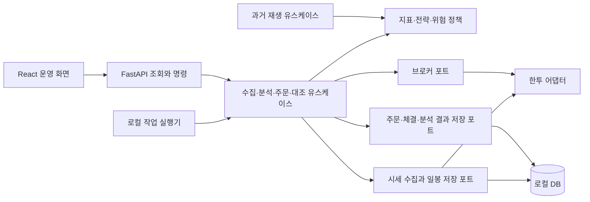

# invest-lab 전수 검토와 구현 우선순위

검토일: 2026-09-27. 기준 커밋: `e3ebdf7a99ffec86b041a42eea9bbd52aea79df2`.

## 판단

**Python/FastAPI + React/Vite + 헥사고날 구조는 유지하는 것이 좋다.** 로컬 분석·계좌 시연의 기반은 갖췄다. 그러나 한투를 연결한 자동 모의투자 서비스에 필요한 데이터 수집, 주문 생애주기, 전략 실행, 백테스트와 운영 복구는 아직 구현 전이다. 프레임워크 교체보다 현재 주문 경계와 데이터 흐름을 먼저 보강할 필요가 있다.

선택한 목표는 **코스피·국내 상장 ETF의 일봉 전체 분석 → 후보 10~20개 장중 감시**, **코스피 상승 추세 눌림목 중심 → ETF 추세 전략과 비교**다. 현재의 단일 검토 점수는 이 두 전략의 구현이 아니다.

이 문서는 조사 결과와 개발 제안이다. 앱 코드를 수정하거나 한투에 접속하지 않았고, `.env`와 사용자 계좌 DB를 읽지 않았다. 주문 재현은 별도의 임시 SQLite와 샘플 데이터로 수행했다. 아래의 결함 재현은 실제 자금 손실이나 한투 장애를 관측했다는 뜻이 아니다.

## 범위와 증거의 한계

- 추적 중인 39개 파일의 역할을 확인하고 백엔드 도메인·포트·유스케이스·어댑터·테스트, 프론트 화면·통신·상태, 실행/의존성 설정, 기존 31개 작업 항목을 대조했다. 의존 라이브러리 전체 소스의 전수 보안 감사는 아니다.
- 기본 테스트를 재실행하고, 시세 변경·일부 조회 실패·주문 응답 유실·중복 시도·전략 충돌을 별도 실험으로 점검했다.
- 실제 증권사 계좌/시세, 전체 종목 처리 성능, 장기 운용, 원격 배포와 모든 브라우저의 동작은 검증하지 않았다. 구현되지 않은 기능은 테스트 통과로 추정하지 않았다.
- 현재 문서의 API 유량 숫자는 기존 조사 문서의 확인일을 따른다. 이번 검토는 계좌별 한도를 실측하지 않았다.

## 1. 이미 갖춘 기반

| 영역 | 확인된 구현 | 근거 |
| --- | --- | --- |
| 계산 | 관측 거래일 기준 7/30/90 수익률, SMA, Wilder RSI, 연속 하락, 거래량 비율, 점수 기여도 | [indicators.py](../backend/src/invest_lab/domain/indicators.py), [계산 테스트](../backend/tests/test_indicators.py) |
| 의존성 분리 | 도메인 계산은 HTTP/DB를 호출하지 않음. Clock·시세·저장소 포트 주입 | [ports](../backend/src/invest_lab/ports/__init__.py), [조립](../backend/src/invest_lab/bootstrap.py) |
| 로컬 계좌 | Decimal 금액, 현금·종목 비중 제한, 원자적 장부 갱신, 동일 request_id 동시 요청 차단 | [trading.py](../backend/src/invest_lab/domain/trading.py), [sqlite.py](../backend/src/invest_lab/adapters/sqlite.py) |
| 전략 설정 | 유효성 검사, 새 버전 저장, 동시 수정 충돌 409 | [models.py](../backend/src/invest_lab/domain/models.py), [HTTP 테스트](../backend/tests/test_http.py) |
| 화면 | 대시보드, 종목 검색/분류/상태·점수 정렬, 상세 차트, 전략 편집, 로컬 매수 기록 | [App.tsx](../frontend/src/App.tsx) |
| 로컬 경계 | loopback 바인딩, Host/Origin 검사, 입력 검증, no-store, 비밀정보·DB Git 제외 | [http.py](../backend/src/invest_lab/adapters/http.py), [실행 스크립트](../scripts/backend.ps1), [.gitignore](../.gitignore) |

이 기반은 재사용할 가치가 있다. 다만 테스트가 보장하는 것은 현재의 샘플 기반 동작이며 실제 증권사의 주문·체결 처리는 아니다.

## 2. 먼저 수정할 문제

아래 우선순위는 한투 연동과 자동화로 확장하기 전의 개발 순서다. 고정 샘플에서만 드러나지 않는 문제는 그 조건을 명시했다.

### A01. 응답 유실 뒤 상세창을 다시 열면 동일 의도의 주문이 추가 기록됨

- 위치: [App.tsx](../frontend/src/App.tsx) 997~1006행, 1121~1124행.
- 주문 식별자가 종목 상세 컴포넌트의 `useState`에만 있다. 서버 처리 후 응답만 유실되고 사용자가 창을 닫았다 다시 열면 새 UUID가 만들어진다.
- 격리한 브라우저 실험에서 서버에 성공적으로 기록된 응답을 끊은 후 같은 주문을 재시도하자 주문 수가 한 건 더 증가했다. 백엔드의 request_id 중복 방지는 서로 다른 UUID까지 막을 수 없다.
- 또한 요청 대기 중 수량을 바꾸면 `buy.reset()`이 pending 상태를 해제하고 새 UUID를 만든다. 첫 1주 주문이 대기 중인 상태에서 2주 주문을 추가로 전송할 수 있었고, 두 주문 모두 저장됐다.
- 수정: 주문 제출 시 의도·수량·ID를 고정하고 pending/결과 불명 상태를 별도 관리한다. 닫기·재진입·새로고침 후에도 서버의 주문 의도를 조회해 확인할 수 있어야 한다. 결과가 불명확하면 새 주문보다 기존 결과 확인을 우선한다. 전송 중 입력 변경은 잠그거나 명시적으로 별도 주문 흐름으로 분리한다.
- 회귀 검증: 서버 처리 직후 응답 유실, 대기 중 편집, 상세창 닫기/재열기, 브라우저 새로고침을 해도 하나의 의도에 하나의 장부 반영만 남는지 확인한다.

### A02. 이미 성공한 주문의 재조회가 새로운 시세 조회에 의존함

- 위치: [service.py](../backend/src/invest_lab/application/service.py) 84~101행 → [sqlite.py](../backend/src/invest_lab/adapters/sqlite.py) 113~119행.
- 기존 request_id 확인보다 종목·시세·전략·평가가격 조회가 먼저 실행된다.
- 임시 DB에서 최초 주문은 HTTP 201이었지만 같은 ID를 시세가 301초 오래된 상태로 재전송하면 HTTP 422가 됐다. 성공 기록은 그대로 한 건 남아 있었다.
- 수정: 애플리케이션에서 먼저 기존 명령 결과를 조회하고, 같은 주문 내용이면 기존 결과를 돌려준다. 최초 요청의 동시성에 대비한 트랜잭션 내부 중복 검사도 유지한다. 주문 결과 조회 API가 필요하다.
- 중요 구분: 이 문제만으로 중복 차감이 발생한 것은 아니다. 성공한 주문을 실패처럼 인식하게 만들고 A01과 같은 재시도 문제를 악화시킨다.

### A03. 매수 비중 계산에 동일 종목의 서로 다른 시세가 섞임

- 위치: [service.py](../backend/src/invest_lab/application/service.py) 89·101행, [sqlite.py](../backend/src/invest_lab/adapters/sqlite.py) 125행, [trading.py](../backend/src/invest_lab/domain/trading.py) 31행.
- 주문 가격을 받은 뒤 전체 종목을 조회하면서 주문 종목도 다시 조회한다. 기존 보유 평가액은 두 번째 가격, 매수 후 종목 비중의 분자는 첫 가격을 사용한다.
- 변동 시세 어댑터 실험: 10만 원에 19주 보유 → 추가 2주 매수의 최초 가격 10만 원, 재조회 가격 13만 원. 한도 20%인데 주문이 허용됐으며 두 번째 가격 기준 최종 비중은 약 25.68%였다.
- 고정된 DemoMarket에서는 나타나지 않지만 실제 시세 공급자를 연결할 때 발생 가능한 계산 계약 문제다. 단순히 체결 후 시장가격 상승으로 한도를 넘는 현상과 구분한다.
- 수정: 기준 시각과 가격을 묶은 평가 스냅샷을 만들어 분자·분모에 같은 평가 기준을 적용한다. 대상 종목을 불필요하게 중복 조회하지 않고, 시세 허용 나이·시각 차이·주문 직전 재검증 정책을 정한다.

### A04. 한 종목 매수에 전체 종목 시세가 필요함

- 위치: [service.py](../backend/src/invest_lab/application/service.py) 22~28·101행.
- 현재 10종목에서 스크리너 한 번은 이력 10회+시세 10회, 매수 한 번은 시세 11회를 호출했다. 이는 현재 포트 호출 수이며 실제 한투 요청 수를 실측한 것은 아니다.
- 보유하지도, 매수하지도 않는 `133690`의 시세 조회만 타임아웃을 주어도 `005930` 매수가 HTTP 500으로 실패했다.
- 수정: 화면은 저장된 분석 결과와 시세 캐시를 읽게 한다. 수집은 별도 작업으로 실행한다. 매수 판단에는 대상+보유 종목의 유효한 평가 데이터만 사용하고 실패/오래된 데이터의 상태를 명시한다.
- 한투 어댑터에서 호출마다 원격 조회하도록 단순 치환하면 전체 종목 수에 비례해 호출량·대기·장애 영향이 증가한다. 현재 화면 요청마다 전체를 조회하는 구조를 그대로 확대하지 않는다.

### A05. 주문에 전략·입력 데이터·위험 판단의 근거가 남지 않음

- 위치: [service.py](../backend/src/invest_lab/application/service.py) 98행, [sqlite.py](../backend/src/invest_lab/adapters/sqlite.py) 33~36·142~150행.
- 주문 필드는 ID, 종목, 수량, 가격, 수수료, 시각, source뿐이다. 전략 버전·신호 ID·시세 기준 시각·평가 스냅샷·위험 검사 결과가 없다.
- 전략 한도를 읽은 직후 다른 요청이 새 버전을 저장하는 상황을 주입하면 이전 한도로 주문되지만 어떤 버전을 적용했는지 기록으로 복구할 수 없다.
- 이전 버전을 고정해 실행하는 설계 자체는 가능하다. **버전 고정 또는 최신 버전 재검증 중 정책을 명시하고 기록하는 것**이 필요하다.
- 수정: `DecisionContext`에 strategy_version, signal_id, data_version/as_of, code_version, 정책 결과를 포함하고 주문 의도와 연결한다.

### A06. 거래량 입력 검증과 전략 불변성의 경계가 약함

- 위치: [indicators.py](../backend/src/invest_lab/domain/indicators.py) 21~29행, [models.py](../backend/src/invest_lab/domain/models.py) 35~56행.
- 거래량은 음수만 거부한다. NaN·무한대·소수·bool이 들어간 Bar를 통과시켰고 계산 결과에도 NaN/무한대가 남았다. 외부 입력 어댑터에서도 명시적으로 검증해야 한다.
- frozen dataclass라도 내부 weights dict는 수정 가능하다. 검증 후 `weights['trend']=999`를 넣으면 가중치 합 1074, 상승 예제 점수 999가 됐다. 현재 HTTP 저장 경로에서는 다시 Strategy를 만들며 검사하므로 이 경로에서 바로 악용된다는 뜻은 아니다.
- 수정: 거래량의 정수·유한·비음수 계약, 일봉 확정 여부·거래일·누락 상태를 검증한다. 전략 가중치는 불변 구조 또는 방어적 복사를 사용한다. [Python frozen dataclass 설명](https://docs.python.org/3.12/library/dataclasses.html#frozen-instances).

### A07. 전략 편집 충돌의 복구 UX가 부족함

- 위치: [App.tsx](../frontend/src/App.tsx) 691~740행.
- 서버의 409 처리는 정상이다. 하지만 충돌 후 최신 버전 불러오기/내 수정 유지/차이 비교 흐름은 없다. 상단 새로고침은 버전 key가 바뀌어 편집기를 다시 만들고 입력 중 초안을 버린다.
- 수정: 충돌 메시지와 함께 최신 설정과 내 초안을 비교하고 재적용할 수 있게 한다. 저장 성공 메시지에는 실제 적용 버전을 표시한다.

### A08. 계좌 로딩을 실제 빈 계좌처럼 표시함

- 위치: [App.tsx](../frontend/src/App.tsx) 204~211·264~326·897~950행.
- 보유 종목이 있는 임시 계좌에서도 `/portfolio` 응답을 지연시키면 현금 100%와 첫 투자 안내가 표시됐다.
- 수정: 최초 로딩, 이전 데이터 갱신 중, 실제 빈 계좌, 실패를 분리한다. 아직 알 수 없는 금액·비중을 0 또는 100으로 추정하지 않는다.

### A09. 좁은 모바일 화면과 기준일 문구의 가독성

- 위치: [styles.css](../frontend/src/styles.css) 141~150·844~849·1410~1420행.
- 390px 화면과 상세창은 가로 넘침이 없었지만, 320px에서는 문서가 383px까지 늘어났다. 가로 메뉴와 필터를 더 좁은 화면에서도 사용할 수 있게 조정해야 한다.
- 분석 기준일 문구는 10px, `#a6aec0`/흰 배경으로 계산 대비 약 2.23:1이다. 실제 시세 전환 시 중요한 정보이므로 크기와 대비를 개선한다.
- 전체 접근성 적합성 심사를 했다는 뜻은 아니다. 현재 기본 레이아웃은 유지하면서 좁은 화면·키보드·가독성 경계를 보강하면 된다.

## 3. 계산식과 전략 평가

### 기존 계산은 유지할 수 있음

- N거래일 수익률은 `100 × (C[t]/C[t-N]-1)`이며 N+1개의 관측치를 사용한다.
- SMA는 기준일을 포함한 최근 N개 종가 평균이다.
- RSI는 최초 14개 변화량 평균으로 시작해 Wilder 평활을 적용한다. 전부 보합일 때 50을 반환하는 프로젝트 정책이 명시돼 있다.
- 연속 하락은 보합에서 끊고, 거래량 비율의 기준 20일에서 당일을 제외한다.
- 부족한 이력을 0으로 채우지 않는 점은 적절하다.

다만 관측치 7개가 언제나 실제 7거래일을 의미하지 않는다. 데이터 누락과 휴장일을 구분하는 실제 캘린더·수집 검증이 필요하다. 계산 라이브러리만 테스트해도 이 공백은 해소되지 않는다.

### 현재 65점은 상승 추세 눌림목의 조건이 아님

하락 종가 `300,299,...,172` 뒤 종가 173, 마지막 거래량 120/이전 100인 입력을 사용하면 현재 코드 결과는 다음과 같다.

```text
종가 173 / SMA120 230.5167 / RSI14 7.1429
점수 66.93
태그 review, oversold, rebound, downtrend
```

따라서 65점 이상을 그대로 신규 자동 매수에 연결하면 선택한 전략과 달리 장기 하락 중 반등도 대상이 된다. 초기 혼합 점수의 정의대로 계산된 것이므로 산술 오류와 구분해야 한다. 강한 추세에서 RSI의 과매도/과매수 상태가 오래 지속될 수 있다는 점도 고려한다. [Fidelity RSI](https://www.fidelity.com/learning-center/trading-investing/technical-analysis/technical-indicator-guide/RSI).

추천 구조는 **데이터·거래 가능성 필터 → 상승 추세 필터 → 눌림과 회복 조건 → 후보 내 순위 → 위험 기반 수량 → 주문 직전 검사**다. 점수는 필터를 통과한 후보를 정렬하는 용도로 둔다. 점수를 상승 확률이라고 표시하지 않는다.

| 우선 추가 | 사용 목적 | 필요한 계약 |
| --- | --- | --- |
| SMA20/60/120, 120일선 기울기 | 중장기 추세와 단기 눌림 구분 | 기울기의 비교 기간·단위, 충분한 초기 이력 |
| ATR14, ATR/종가 | 변동성, 손절 거리와 수량 계산 | TR=max(H-L, abs(H-Cprev), abs(L-Cprev)); Wilder 초기값·워밍업 |
| `(C-SMA20)/ATR14` | 종목 변동성 차이를 반영한 눌림 정도 | ATR=0이면 계산 불가/제외, 수정 가격 일치 |
| 시장 대비 63거래일 상대 수익 | 시장 상승에 동반된 상승과 상대 강도 구분 | 같은 통화·세션·수익률 기준의 벤치마크 |
| 거래대금·스프레드·거래 가능 상태 | 체결 가능성과 비용 검토 | 거래량만으로 다른 종목의 유동성 비교 금지 |
| 보유 비중·업종·동일 ETF 지수 노출 | 집중 위험 관리 | 기존 보유와 미체결 매수 예약 포함 |
| 실현/미실현 손익·순자산 추이·낙폭 | 매도 및 전략 성과 평가 | 비용·입출금·배당·평가 시점 일치 |

ATR는 방향 예측값이 아니라 변동성 측정값이다. [Fidelity ATR 공식](https://www.fidelity.com/learning-center/trading-investing/technical-analysis/technical-indicator-guide/atr). RSI 범위·ATR 배수·최대 보유기간은 [지표 연구 명세](indicator-catalog.md)의 실험 후보로 유지하고 결과를 보고 임의로 확정하지 않는다.

코스피 눌림목과 ETF 추세를 독립적인 전략 타입으로 구현한다. 각 전략은 진입뿐 아니라 청산, 수량, 신호 유효기한, 갭 처리, 주문유형과 미체결 정책을 가져야 한다. ETF의 분배금·환헤지·같은 지수 중복 노출은 비교에 필요한 메타데이터부터 먼저 넣는다. PER/PBR·재무·매크로·ML은 그 뒤 별도 실험으로 추가한다.

백테스트에는 다음 세션 체결, 원주가/수정주가 역할, 기업행동·배당 이중 반영 방지, 과거 종목 구성/상장폐지, 미체결·호가·비용 가정이 필요하다. 일봉 고가/저가만으로 같은 날 손절과 익절 중 먼저 발생한 순서를 알 수 없으므로 보수적 규칙이나 더 세밀한 데이터가 필요하다. 한투 모의 체결 결과만으로 실전 체결 품질을 동일하다고 가정하지 않는다.

시간순 구간으로 검증하고 같은 날짜의 여러 종목이 서로 다른 학습/검증 구간에 섞이지 않게 날짜 단위로 분할한다. 단순 TimeSeriesSplit 사용만으로 공시 시점·종목 패널·겹치는 목표 기간 누출이 자동 해결되지는 않는다. [시간순 분할](https://scikit-learn.org/stable/modules/generated/sklearn.model_selection.TimeSeriesSplit.html), [과도한 전략 탐색과 백테스트 과적합 연구](https://www.davidhbailey.com/dhbpapers/backtest-prob.pdf).

## 4. 아키텍처 평가와 확장 방향

### 유지할 것

Python의 순수 계산과 FastAPI 진입점을 분리하고 React/Vite는 내부 운영 화면으로 유지한다. 현재 기능 규모에서 마이크로서비스·분산 큐나 프레임워크 전환이 필요하다는 증거는 없다. 단일 저장소의 모듈형 애플리케이션으로 개발하고, 수집/계산 작업자만 화면 요청과 분리하면 된다.

SQLite도 당장 교체할 필요는 없다. 로컬에서 짧은 쓰기 트랜잭션을 유지하고 실제 잠금 지연을 측정한다. 여러 서버의 쓰기 병렬성이나 원격 DB가 필요할 때 PostgreSQL 같은 서버 DB를 검토한다. SQLite는 한 시점에 한 writer라는 제약이 있다. [SQLite 사용 지침](https://www.sqlite.org/whentouse.html).

### 보강할 경계

1. `PortfolioRepository.buy()`는 지금 로컬 체결과 저장을 함께 담당한다. 증권사 HTTP 주문은 SQLite 트랜잭션과 하나로 커밋할 수 없으므로 `Broker`, `OrderRepository`, 체결 반영 유스케이스를 분리한다.
2. `MarketData`의 원격 수집, 과거 데이터 저장, 화면용 조회를 분리한다. 과거 조회에는 기준 시점/세션/수정 기준을 전달하고 백테스트에는 그 시점 이후 데이터가 보이지 않게 한다.
3. `AccountSnapshot`, `OrderIntent`, `OrderReceipt`, `Fill`, `DecisionContext`, `DataQuality` 같은 타입을 도입한다. 원시 dict로 모드·시간·금액·주문 상태의 의미를 전달하지 않는다.
4. `http.py:10`이 SQLite에 정의된 `VersionConflict`를 직접 import한다. 예외 계약은 application/domain으로 옮겨 DB 어댑터를 바꿔도 HTTP 계층이 바뀌지 않게 한다.
5. `domain → application` 역참조와 상대 import 등도 아키텍처 검사에 포함한다. 현재 테스트는 일부 프레임워크와 adapter 절대 import만 검사한다.
6. 실행 모드와 기능을 검증된 설정으로 조립한다. `local_simulation`, `kis_paper`, `kis_live`의 계좌·자격증명·DB·주문 경로를 구분하고 오류 시 다른 모드로 자동 대체하지 않는다.



백테스트·모의·실전이 같은 전략과 위험 계산을 공유하되 체결 구현은 분리한다. 헥사고날 구조는 이 교체를 돕지만, ASGI 실행·영속 파일·스케줄링·비밀 관리까지 모든 호스팅에서 동일하게 만들어 주지는 않는다.

### 주문 생애주기

최소한 의도 생성 → 전송 대기 → 접수/거부/결과 불명 → 부분 체결/전체 체결 → 취소 요청/취소 확인을 구분한다. 체결과 취소 통보의 순서 역전도 처리해야 한다. HTTP 성공을 즉시 보유 증가로 처리하지 않는다. 한투는 주문 API와 일별 주문·체결 조회 API를 별도로 제공한다. [공식 주문 예제](https://github.com/koreainvestment/open-trading-api/blob/main/examples_llm/domestic_stock/order_cash/order_cash.py), [주문·체결 조회 예제](https://github.com/koreainvestment/open-trading-api/blob/main/examples_llm/domestic_stock/inquire_daily_ccld/inquire_daily_ccld.py).

서버가 의도를 먼저 저장하고 전송 작업이 이를 처리하도록 한다. 전송 직후 프로세스가 종료되면 상태를 불명으로 두고 브로커 내역과 대조한다. 로컬 UUID/DB 트랜잭션만으로 외부 증권사 주문의 exactly-once 실행이 보장된다고 가정하지 않는다.

## 5. 프론트엔드와 API 계약

- **화면 표시**: 계좌 모드, 실제 계좌 연결 여부, 가격 시각, 확정 일봉 기준일, 마지막 수집 성공, 데이터 지연/누락, 미확인 주문을 분리해 보여준다. 현재 샘플은 2026-09-24 종가에 조회 시각을 붙이므로 이 시각을 실제 시장 최신성의 증거로 전용하지 않는다.
- **계좌**: 현금·주문 가능액·결제 예정액·보유 평가액·실현/미실현 손익을 구분한다. 현금 0, 미조회, 오류는 서로 다른 상태다.
- **종목**: 현재가·전일 확정 지표·전략별 통과/제외 이유를 제공한다. 전체 종목 확대 후 검색·정렬·페이지 또는 가상 스크롤 성능을 실제 데이터로 측정한다.
- **주문**: 매수·매도·취소, 주문 예상 금액/비용/최대 수량, 진행·결과 불명·부분 체결을 보여준다. 마지막 100개만 조회하는 현재 계좌 응답에서 주문 조회·페이지 API를 분리한다.
- **전략**: 타입 선택, 고정 버전, 초안/운용 버전 구분, 진입·청산·수량 규칙과 충돌 복구 UI가 필요하다.
- **성과**: 일별 순자산, 비용 후 수익률·MDD·손익비·거래 수·시장 노출, 전략별 벤치마크, 주문 실패/대조 불일치 기록을 연결한다.
- **분리**: 1,239행 App.tsx를 계좌/종목/전략/주문 기능으로 나누고 차트·표·모달·공통 상태를 분리한다. 줄 수 자체가 성능 결함이라는 뜻은 아니며 변경과 테스트 범위를 줄이기 위한 제안이다.
- **갱신**: `staleTime: 30000`은 30초마다 갱신하는 설정이 아니다. 현재 주기적 감시가 없으므로 실제 감시 기능에는 polling/SSE/WebSocket, 재연결과 최신성 기준을 명시한다. [TanStack Query 기본 동작](https://tanstack.com/query/latest/docs/framework/react/guides/important-defaults).
- **응답 계약**: 현재 OpenAPI의 7개 operation 성공 응답 schema가 모두 `{}`다. HTTP 반환 모델이 없고 프론트의 수동 타입 단언은 실행 중 응답 검증이 아니다. 응답 DTO, 표준 오류 코드·재시도 가능 여부·request_id, 필요하면 OpenAPI 기반 TypeScript 생성/계약 검사를 도입한다. [FastAPI response model](https://fastapi.tiangolo.com/tutorial/response-model/).
- **요청 수명**: `api.ts:96~111`에 timeout/AbortSignal 전달이 없다. 조회에는 제한 시간과 취소를 연결하고, 주문 요청의 타임아웃은 실패 확정 대신 결과 불명으로 표시해 대조한다. 자동 POST 재전송으로 해결하지 않는다.
- **차트 계약**: `App.tsx:1147~1163`에서 SMA를 별도로 계산한다. 현재 식은 맞지만 백엔드와 초기 이력·기간·결측 처리 규칙이 바뀌면 차트와 수치가 달라질 수 있으므로 같은 fixture로 일치 검사를 둔다.
- **접근성**: 현재 버튼 이름·상태 알림·네이티브 dialog와 Esc 동작은 재사용한다. 키보드 포커스 복귀, 차트의 대체 데이터, 색상 이외 등락 표시와 확대/긴 종목명 상황을 회귀 검증에 포함한다.

## 6. 운영·보안·테스트

### 로컬 단계에서 추가

- DB 스키마 버전과 순차 마이그레이션. `CREATE TABLE IF NOT EXISTS`는 기존 테이블을 새 구조로 변경하지 않는다.
- 일봉 수집·신호·주문·대조 각각의 작업 ID/시작·종료·대상 세션/성공·실패 기록. 작업 중복 방지와 데이터 체크포인트.
- 절전/프로세스 종료 후 보유·미체결 대조를 먼저 하고 만료된 과거 신호를 무조건 따라 주문하지 않는 복구 정책.
- 원본 시세→정규화→확정 일봉→전략 입력→신호→주문→체결의 추적 가능성.
- 백업과 실제 복원 시험. 실행 중 SQLite의 안전한 백업 방식을 사용한다. [SQLite Backup API](https://www.sqlite.org/backup.html).
- liveness와 readiness를 구분한 상태 확인. 현재 `/api/health`는 DB·공급자·최근 작업을 검사하지 않는 정적 응답이다.
- 설치와 실행 분리. 지금 시작 스크립트의 `npm ci`/`uv sync`는 개발 편의용이며 장중 재시작마다 설치에 의존하지 않게 한다.
- 키·토큰·계좌번호를 원본 로그/오류/추적에 남기지 않고, 환경별 자격증명 혼용을 검사한다.

### 원격 운영 시 추가

현재는 개인 PC loopback 서비스다. Host/Origin 검사는 인증이 아니므로 원격 공개 전 인증·권한·TLS·허용 Host/Origin·비밀 관리·영속 DB·서비스 재시작 설정이 필요하다. `noindex`도 접근 통제가 아니다. 실제 계좌 화면을 개인 소개 사이트와 같은 공개 접근 정책으로 배포하지 않는다.

### 반복 가능한 검증으로 남길 항목

1. A01~A09 재현을 회귀 테스트로 고정한다. 브라우저 E2E는 응답 지연·유실, 재진입·새로고침, 서버 충돌을 포함한다.
2. 일봉/지표는 독립 수작업 예제, 결측·중복·휴장·분할·0거래량·비정상 수치·워밍업·미래 구간 변경 검사를 한다.
3. 브로커는 마스킹한 응답 fixture로 연속 조회, 부분 체결, 중복 통보, 순서 역전, 타임아웃 뒤 접수 성공, 계좌/모드 혼용을 검증한다.
4. DB는 마이그레이션·백업 복원·동시 주문·프로세스 재시작, 작업자는 중복 실행·누락 감지를 검증한다.
5. CI에서 pytest/Ruff/TypeScript/build/프론트 테스트/계약 검사를 실행한다. 현재 저장소에는 CI와 재실행 가능한 프론트 테스트 명령이 없다.
6. 전체 종목의 초기 적재/증분 수집 시간, 호출량, 메모리, 분석 시간, 화면 응답 시간, DB 잠금 대기를 측정한 뒤 최적화한다.

## 7. 기존 31개 로드맵과 실제 구현 대조

‘부분 기반’은 재사용할 코드가 있다는 뜻이다. [기존 로드맵](research-roadmap.md)의 완료 기준을 충족한 것은 아니다. 원래 모두 후속 항목으로 작성된 목록이므로 아래 완료 0개를 전체 앱 개발 진척 0%로 해석하면 안 된다.

| ID | 상태 | 남아 있는 핵심 |
| --- | --- | --- |
| K01 | 미구현 | 모드별 자격증명·계좌·토큰 관리 |
| K02 | 미구현 | 실제 현재가·호가·시장 시각 |
| K03 | 미구현 | 브로커 보유·잔고·주문 가능액 전체 페이지 |
| K04 | 미구현 | 외부 모의 매수·매도; 현재 로컬 매수만 있음 |
| K05 | 부분 기반 | 로컬 멱등성 있음; 외부 주문 상태·체결·취소·대조 없음 |
| K06 | 미구현 | 호출 큐·한도·캐시·우선순위 |
| D01 | 부분 기반 | 정적 10종목 있음; 전체/과거 마스터 없음 |
| D02 | 미구현 | 실제 거래일·거래 정지·시장 세션 |
| D03 | 미구현 | 실제 일봉 수집·영속 저장·증분 갱신 |
| D04 | 미구현 | 수정/원주가·기업행동·분배금 |
| D05 | 미구현 | 시장 데이터 버전·재현·백업 복구 |
| I01 | 부분 기반 | 기본 지표와 테스트 있음; 실제 데이터 계약 미완성 |
| I02 | 미구현 | ATR·상대 강도·유동성 |
| S01 | 부분 기반 | 혼합 점수만 있음; 독립 전략·진입/청산/수량 없음 |
| S02 | 부분 기반 | 설정 버전만 있음; 코드·데이터·실험·신호 연결 없음 |
| R01 | 부분 기반 | 현금/종목 한도 있음; 업종·ETF·대기 주문 위험 없음 |
| R02 | 미구현 | 운용 중지·손실 한도·재개 정책 |
| B01 | 미구현 | 시점 제한 과거 재생·체결 엔진 |
| B02 | 부분 기반 | 가정 수수료만 있음; 백테스트 비용/미체결/배당 없음 |
| B03 | 미구현 | 시간순 검증·민감도·벤치마크 |
| O01 | 미구현 | 스케줄링·중복 실행 방지·누락 복구 |
| O02 | 미구현 | 브로커 주문/체결/잔고 대조 |
| O03 | 부분 기반 | 기본 HTTP 상태·오류 있음; 운영 진단 없음 |
| U01 | 부분 기반 | 샘플 안내·기여도 있음; 다중 모드·지연·제외 사유 없음 |
| U02 | 부분 기반 | 설정 버전·관심 종목 있음; 실험/성과/일지 없음 |
| E01 | 미구현 | ETF 특화 데이터·지표 |
| F01 | 미구현 | 당시 공시·가치/품질 |
| M01 | 미구현 | 당시 공개된 거시/심리 데이터 |
| ML01 | 미구현 | 통계 모델 비교 |
| L01 | 미구현 | 실전 조회·주문 |
| H01 | 부분 기반 | 코드 경계 있음; 원격 운영 구성 없음 |

## 8. 권장 개발 묶음과 완료 기준

| 순서 | 작업 묶음 | 다음 단계로 넘어갈 증거 |
| --- | --- | --- |
| 0 | 주문 재시도·시세 스냅샷·API 계약·회귀 테스트 | A01~A08 회귀 검증과 기존 동작 통과; A09는 UI 보완 묶음으로 병행 |
| 1 | 한투 읽기 전용 연결 + 실제 일봉 저장 | 소수 종목 시세/잔고 대조, 모든 페이지 조회, 증분 재실행 동일, 누락/휴장 구분, 샘플 자동 대체 없음 |
| 2 | 수동 모의 매수·매도·취소·체결 대조 | 응답 유실/재시작/부분 체결/중복 통보에도 브로커와 수량·현금 일치 |
| 3 | 독립 전략 + 백테스트 | 같은 입력 재현, 미래 정보 차단, 다음 세션 체결·비용 후 성과·전략별 벤치마크 |
| 4 | 매일 전체 분석 + 후보 감시와 제한된 모의 자동화 | 작업 중복 차단, 보유/후보 구독 복구, 가격 지연 표시, 중지 정책, 절전 후 대조부터 수행 |
| 5 | 한 달 운용 기록·평가 | 모든 체결의 근거 추적, 전략 성과와 실행 오류를 분리해 보고 |

2와 3은 데이터 기반이 마련되면 일부 병행할 수 있지만, 자동 주문에는 두 단계의 완료가 모두 필요하다. 실전 전환은 별도 판단이다.

추가로 명세화할 세부 정책은 **후보 10~20개의 선택·동률·교체, 보유 종목과 후보의 감시 슬롯 배분, 신호 만료, 갭 발생 시 진입/취소, 주문의 호가 단위·최소 수량·거래 정지 대응**이다. 이들은 기존 S01/K05/D02/O01의 구체화이며 새 지표를 무한히 추가하는 작업과 구분한다.

한 달 모의운용의 첫 완료 기준은 수익률 수치보다 데이터→신호→주문→체결→잔고의 일관성과 복구 기록이다. 전략 평가는 비용 후 수익·낙폭·손익비·거래 수·벤치마크·불확실성을 함께 보고, 한 달 승률만으로 확정하지 않는다.

## 9. 이번 검증 기록

- `uv run --frozen pytest -q`: 27개 통과. Starlette/httpx 테스트 클라이언트 관련 deprecation warning 1건.
- `uv run --frozen ruff check .`, `uv run --frozen ruff format --check .`: 통과.
- 번들 Node를 사용한 `npm run build`, `npm run format:check`: 통과. JS 328.80kB / gzip 103.56kB, CSS gzip 5.37kB. 전체 종목 성능을 측정한 수치는 아니다.
- 격리 Headless Edge: 1440×1000, 390×844, 320×780. 대시보드, 10종목 조회, 미국 지수 ETF 2종목 필터, 검색/빈 결과, 상세/차트/Esc, 매수/잔고 반영, 전략 저장과 충돌을 확인했다. 정상 흐름 JS 예외 없음.
- 주문 응답 보류 후 수량 1→2 변경: 서로 다른 ID로 두 주문 저장. 응답 유실 실험: 기존 3건 → 서버 처리 후 4건 → 재개방 재시도 후 5건. 초안 유실과 로딩/빈 계좌 혼동도 확인했다.
- 브라우저 실험은 임시 DB, 백엔드 18117·프론트 15173을 사용했다. 브라우저 API 요청을 해당 백엔드로 보내고 다른 포트 시험을 위해 Origin만 기존 허용 값으로 변경했다. 기존 실행 스크립트의 전체 네트워크/배포 구성을 그대로 검증한 것은 아니다. 감사용 프로세스는 종료했다.
- OpenAPI 생성 확인: 7개 operation의 성공 응답 schema가 모두 비어 있음.
- 임시 DB 장애 주입: 성공 주문의 stale-quote 재시도 422, 무관 종목 timeout 시 주문 500, 다른 평가 가격 혼용에 의한 비중 한도 문제, 전략 버전 귀속 누락 확인.
- 계산 경계: 하락 추세 66.93점, 비정상 거래량 통과, nested weights 변경으로 점수 999 재현.
- npm 잠금 파일 advisory 조회: `npm audit --json --package-lock-only --ignore-scripts`, 알려진 취약점 0건.
- Python 설치 의존성 25개 이름/버전을 OSV querybatch로 조회: 알려진 advisory 0건. 비밀정보나 소스 코드는 전송하지 않음.
- 의존성 조회 결과는 조회 시점에 알려진 일치 advisory가 없다는 의미다. 앱 보안이나 모든 공급망 위험을 증명하지 않는다.

기존 앱 소스·잠금 파일은 변경하지 않았다. 이번 결과물은 이 검토 보고서와 README의 문서 링크다. 위 결함은 아직 수정되지 않았으며 다음 구현 묶음에서 회귀 테스트와 함께 처리해야 한다.
