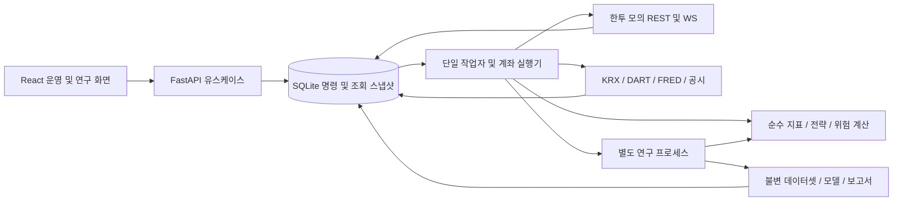

# 실제 모의투자 완성 계획

작성·공식 자료 확인: 2026-09-27. 기준 코드: `e3ebdf7a99ffec86b041a42eea9bbd52aea79df2`.

**목표는 로컬에서 실제 한투 모의계좌를 운용하는 연구·운영 서비스를 완성하는 것이다.** 사용자가 추가한 재무·매크로·통계모델도 이번 납품 범위에 포함한다. 기존 31개 작업 중 29개를 포함하고, 실전 거래 L01과 원격 배포 H01만 후속으로 남긴다. 과거 문서의 E01/F01/M01/ML01 ‘P2·확장’ 표기는 이 계획으로 대체한다.

이 문서는 조사와 작업 계획이다. 이번 계획 작성 중에는 앱 기능을 구현하거나 비밀파일을 읽거나 증권사 인증·계좌·주문 API를 호출하지 않았다. 아래 API 이름·스키마·실험 설정은 별도 표시가 없으면 구현 제안이며 현재 동작하는 기능을 뜻하지 않는다.

관련 근거: [기존 결함·미구현 감사](2026-09-27-e2e-audit.md), [실제 연결 검사](2026-09-27-kis-connection-check.md), [데이터·외부 API 세부 명세](paper-investment-data-contracts.md), [기존 31개 항목](research-roadmap.md).

## 1. 완성할 결과

| 영역 | 이번에 완성할 기능 |
| --- | --- |
| 실제 모의계좌 | 현금·주문 가능액·보유 평가액·손익, 매수·매도·정정·취소, 접수·부분 체결·미체결·거절·결과 불명, 잔고 대조 |
| 종목 분석 | 코스피 주식·국내 상장 ETF 카탈로그, 7/30/90거래일 등락, 90/120일선, RSI·ATR·상대 강도·유동성, 통과·제외 근거 |
| 전략 | 코스피 상승 추세 눌림목, ETF 추세 비교, 재무 가치·품질 필터와 매크로 위험 조절의 독립 비교 |
| 연구 | 당시 이용 가능했던 데이터로 백테스트, 비용·기업행동·미체결 반영, 시간순 검증, Ridge·로지스틱 회귀 학습/비교/등록 |
| 자동 운영 | 확정 일봉 전체 분석, 다음 거래일 후보 10~20개와 보유 감시, 작업 스케줄·중지·재시작·대조·일별 보고 |
| 화면 | 대시보드, 종목/후보, 주문, 전략 버전, 재무·매크로·모델·백테스트 연구실, 운영/성과 화면 |
| 운용 관찰 | 위 기능으로 실제 한 달간 기록하고 월간 보고. 무거래일도 정상 조건 불충족과 장애를 구분 |

완성 판정은 세 가지로 분리한다. **기능 완성(W01~W17), 실제 한 달 관찰 완료(W18), 전략 채택 여부**다. 모델이 규칙 전략보다 나쁘면 그 평가 결과와 비활성 상태를 남긴다. 수익을 낼 때까지 무한 튜닝하는 것을 소프트웨어 완료 조건으로 삼지 않는다.

실전 키·실전 주문 활성화, 클라우드 구입·배포, 분봉 초단타, LLM 판단, 레버리지·인버스 자동 운용은 이번 납품에 포함하지 않는다. 카탈로그에는 상품을 숨기지 않고 자동 전략 제외 이유를 표시한다.

## 2. 현재 증거와 아직 없는 것

- 현재 앱은 `DemoMarket + SQLite`이며, 10개 샘플 종목과 로컬 매수 장부를 사용한다. 한투 어댑터·매도·수집·자동 작업·백테스트는 없다.
- 앞선 감사에서 백엔드 27개 테스트와 정적 검사, 프론트 빌드/포맷 검사가 통과했다. 이는 현재 샘플 기능의 결과다. 이번 문서 작성에서는 변경하지 않은 앱 테스트를 반복하지 않는다.
- 2026-09-27 01:40 KST 별도 진단에서 **모의 인증·현재가·잔고 조회는 성공**, 주문은 0건이었다. HTS ID 기반 실시간 통보와 실제 모의매매는 아직 미검증이다.
- `.env`는 설명식 형식이므로 정식 설정으로 표준화해야 한다. 계좌 상품코드 `01`은 앞선 잔고 조회로 확인했다. 비밀값은 보고서·Git·브라우저에 넣지 않는다.
- 기존 A01~A09 결함 외에 **A10: 영숫자 ETF 코드 거부**를 발견했다. 현재 `^\d{6}$` 검사는 실제 코드 `0048K0`을 거부하므로 API부터 데이터셋까지 문자열 식별자 계약을 바꾼다. [KIND 공식 종목 공시](https://kind.krx.co.kr/external/2026/01/15/000034/20260115000051/68629.htm).

## 3. 이번 조사로 정한 기술 구성

**Python 3.12 + FastAPI / React + TypeScript + Vite를 유지**한다. 내부 서비스이므로 프론트 프레임워크를 교체할 이유가 없다. 도메인과 애플리케이션은 외부 API·웹 프레임워크·DB에 의존하지 않는 구조를 유지한다.

| 구성 | 선택과 이유 |
| --- | --- |
| 실행 | API 프로세스 + 계좌별 실행 권한을 독점하는 단일 작업자. 계산/학습은 별도 제한된 프로세스에서 수행해 주문 확인을 막지 않음 |
| 운영 저장소 | 기존 SQLite 유지, 짧은 트랜잭션·WAL·busy timeout·명시적 순차 SQL migration. `schema_migrations(version, checksum, applied_at)` 기록 |
| 연구 저장소 | 검증된 일봉/재무/매크로 원장은 저장소 포트로 관리. 실험 입력은 불변 Parquet + manifest/hash로 내보내고 운영 DB의 실험 ID와 연결 |
| 계산·모델 | NumPy/pandas, scikit-learn의 Ridge·LogisticRegression·Pipeline. 의존성은 실제 구현 때 호환 버전으로 잠금 |
| 통신 | httpx REST + WebSocket 어댑터. 계좌별 공통 호출 큐, 토큰 캐시, 지원 기능 목록 명시 |
| 작업 | DB 작업 테이블의 고유 키·lease·heartbeat·checkpoint. 단일 스케줄 작업자가 만료/복구를 책임짐 |
| 프론트 계약 | FastAPI의 명시적 Pydantic 성공/오류 DTO → OpenAPI → TS 타입 생성. TanStack Query는 서버 캐시를 조회 |
| 검증 | pytest/Ruff, Vitest + Testing Library, Playwright 핵심 E2E, CI의 타입 생성 차이·빌드·비밀정보 노출 검사 |

SQLite는 로컬 요구에 맞춘 선택이다. 저장소 포트와 트랜잭션 경계를 지켜 이후 PostgreSQL 등으로 옮길 수 있게 한다. 인프라 교체에는 배포 어댑터·실행 환경 작업이 필요하며, Python API·상시 작업자·학습을 Cloudflare Workers에서 그대로 실행할 수 있다는 의미는 아니다.

권장 경계는 `MarketDataProvider`, `UniverseRepository`, `BarRepository`, `CorporateActionRepository`, `FundamentalProvider`, `MacroProvider`, `Broker`, `OrderRepository`, `PortfolioRepository`, `StrategyRepository`, `ExperimentRepository`, `Model`, `TradingCalendar`, `Clock`, `JobRepository`다. `PortfolioRepository.buy()`에 외부 주문을 끼우지 않고 주문 접수·체결·계좌 투영을 분리한다. HTTP가 SQLite 예외를 직접 가져오는 의존성도 애플리케이션 오류로 바꾼다.

## 4. 먼저 확보할 외부 조건

한투 주문·취소가 지원된다고 해서 모든 조회도 지원되는 것은 아니다. 공식 포털의 모의 지원 필드와 공개 예제를 대조했다. **정정취소가능조회·매도가능조회·휴장일조회·WS 장운영/VI는 모의 미지원**이다. 주문내역/잔고 대체 경로와 거래 달력을 구현하고 실제 모의 세션에서 검증해야 한다. [정정취소가능조회](https://apiportal.koreainvestment.com/apiservice-apiservice?/uapi/domestic-stock/v1/trading/inquire-psbl-rvsecncl), [매도가능조회](https://apiportal.koreainvestment.com/apiservice-apiservice?/uapi/domestic-stock/v1/trading/inquire-psbl-sell), [휴장일조회](https://apiportal.koreainvestment.com/apiservice-apiservice?/uapi/domestic-stock/v1/quotations/chk-holiday).

| 준비 | 필요 작업 | 완료 증거 |
| --- | --- | --- |
| 한투 모의 | 기존 설정 표준화, 키/계좌/HTS 연결과 모의계좌 유효성 확인 | 실제 앱 읽기, 장중 WS, 모의 주문·체결 대조 기록 |
| OpenDART | [인증키 신청/관리](https://opendart.fss.or.kr/)에서 키 발급 | 공시 목록·원문·재무 소량 검증, 정정 전후 원문 보존 |
| FRED | [공식 API 키 안내](https://fred.stlouisfed.org/docs/api/api_key.html)에 따라 키 발급 | 선택 시리즈와 vintage 조회, 이용 가능 시각/수정 이력 검증 |
| KRX OpenAPI | 인증키와 유가증권 일별매매·종목기본정보·ETF 일별매매 등 개별 서비스 신청 | 승인 후 필드·이력·상장폐지 포함 여부를 실제 표본으로 검증 |
| 거래 달력 | 공식 KRX 공지/자료의 정규장·특별 휴장·개장 변경을 가져오는 버전형 공급원 | 미래 운용 세션 검증, 변경 출처/효력일 기록. 단순 평일 계산 금지 |
| 역사 데이터 | 당시 유니버스·상장폐지·기업행동·ETF 분배금·기준 지수와 재무 원본 확보 | 기간·종목·필드별 coverage 보고서 통과 |

KRX는 키 발급 외에 **서비스별 활용 승인**이 필요하다. [공식 이용 절차](https://openapi.krx.co.kr/contents/OPP/INFO/OPPINFO003.jsp). 신청은 초기에 병행한다. 키가 없더라도 계약·fixture·화면 개발은 진행할 수 있지만 실제 연동 완료로 표시하지 않는다. 신규 키는 구현할 표준 `.env`의 `DART_API_KEY`, `FRED_API_KEY`, `KRX_API_KEY` 등에 로컬 저장하고 채팅에 복사하지 않는다.

**역사 데이터는 첫 번째 선행 검증 대상이다.** 우선 약 5년을 연구 목표 구간으로 잡고 필요한 워밍업 기간을 추가한다. 이는 확보된 이력을 뜻하지 않는다. W05/W10~W12에서 표본을 검증한 뒤 전체 범위를 확정한다. 무료 원천으로 빠지는 구간은 공시/승인된 가져오기 자료로 보완한다. 유료 데이터가 필요하면 정확한 결손·대안·가격을 조사한 뒤 별도로 결정하며 현재 계획은 구매를 포함하지 않는다.

당시 구성종목이나 최초 공개본이 없으면 결과에 `survivorship_limited` 또는 `revised_only`를 표시한다. 이런 결과는 탐색에는 쓸 수 있어도 **전체 PIT 검증 G3의 통과 증거로 쓰지 않는다.** 범위를 줄여야 할 때는 데이터 결손을 공개하고 계획을 명시적으로 갱신한다.

## 5. 주문·위험·복구의 불변 규칙

1. 모드는 기존 이름을 유지해 `local_simulation` / `kis_paper`로 구분한다. 계좌·DB 기록·브라우저 캐시·실험에 모드가 붙는다. `kis_live` 실행 경로는 이번에 활성화하지 않는다.
2. 사용자 요청 ID와 주문 내용을 브로커 전송 전에 영속 저장한다. 같은 ID·같은 내용은 저장 결과를 먼저 반환하고, 같은 ID·다른 내용은 충돌로 거부한다. 이미 성공한 결과를 새 시세 조회 실패 때문에 숨기지 않는다.
3. 전송 중·결과 불명 상태에서 수량·ID를 변경하지 않는다. 창 닫기·재진입·새로고침 이후에도 서버의 의도를 조회한다. 응답이 없다고 새로운 ID로 자동 제출하지 않는다.
4. POST 직전 `SENDING`을 기록하고 네트워크 요청 중 DB 잠금을 유지하지 않는다. 응답 유실/프로세스 중단은 `UNKNOWN`이다. 일반 작업 재시도로 주문·정정·취소 POST를 다시 보내지 않는다.
5. KIS가 로컬 요청 ID로 중복 주문을 차단한다는 계약은 확인되지 않았다. **로컬 멱등성만으로 외부 exactly-once를 보장한다고 설명하지 않는다.** 불명 결과는 주문내역 전체 페이지·통보·잔고로 대조하고, 일치 후보가 하나로 확정되지 않으면 새 진입을 멈춘다.
6. 접수, 체결, 취소 요청, 대조 상태를 분리한다. `주문 10 / 체결 4 / 취소 6`을 표현하고 정정 주문의 원주문 chain을 보존한다. 취소 요청 중 추가 체결도 수용한다.
7. REST 누적 체결 수량·금액과 주문번호/원주문을 기준으로 중복·역순 WS를 대조한다. 초 단위 시각+가격+수량만으로 체결을 중복 제거하지 않는다. 외부 HTS 주문은 별도 출처로 가져온다.
8. 위험 검사는 같은 기준의 `ValuationSnapshot`을 쓴다. 주문 종목과 실제 보유 종목, 미체결 예약만 평가한다. 무관한 전체 종목 조회 실패가 주문을 막지 않는다. 필요한 보유 가격이 오래되면 차단 이유를 표시한다.
9. 현금·매도 가능 수량은 브로커가 이미 반영한 예약과 아직 반영하지 않은 로컬 예약을 구분한다. 동일 예약을 두 번 차감/해제하지 않는다. 신용·미수 없이 현금 주문만 허용한다.
10. 신호·전략·모델·데이터·시세·잔고·위험 설정 버전을 주문에 연결한다. 장중 전략 초안 저장으로 이미 고정한 운용 버전이 바뀌지 않는다.
11. 오래된 시세, 거래 가능 여부 미확인, 데이터 품질 실패, 결과 불명 주문, 잔고 대조 불일치에서는 신규 진입을 제한한다. 청산도 무조건 실행하지 않고 시세·거래 가능성·매도 수량을 확인한다.
12. 중지 정책은 `신규 진입 중지`, `미체결 취소 시도`, `기존 포지션 유지/정의된 청산`을 구분한다. 네트워크 장애가 있다고 전량 시장가 청산으로 임의 전환하지 않는다.
13. 첫 달은 계좌에 **선택한 운용 구성 하나**를 활성화하고 다른 규칙/모델은 shadow로 비교한다. 운용 구성에 코스피/ETF가 함께 있으면 자금 배분·종목 소유 규칙을 고정한다. 외부 HTS/수동 보유는 위험 노출에는 포함하되 명시적으로 할당하기 전 자동 청산하지 않는다. 전략이 관리하는 수량·수동 수량·체결/손익 귀속을 기록하고 외부 매도로 할당이 깨지면 중지·대조한다.
14. 로컬 계좌 실행기는 프로세스 수명 동안 OS 배타 잠금을 보유한다. 작업 lease가 만료됐다는 이유만으로 살아 있는 구 실행기와 새 실행기를 동시에 전송시키지 않는다. DB 실행권 세대 번호와 전송 직전 소유권 검사도 적용하며, 잠금 인수 시 기존 `SENDING`은 `UNKNOWN`으로 대조한다. DB fencing만으로 이미 브로커에 나간 요청을 취소할 수 있다고 가정하지 않는다. 절전 복귀·지연 응답·프로세스 종료 fixture로 검증한다.
15. 지정가/가격정정에는 상품별 호가단위·당일 상하한가·매수/매도 방향의 가격 조정 규칙을 적용한다. 가격을 유효 호가로 바꾼 뒤 수량·예약금·위험을 다시 검사한다. broker 주문 식별은 모드·계좌·거래일·주문번호 범위를 사용하고 지점/거래소도 보존한다. 날짜/계좌가 다른 같은 주문번호를 합치지 않는다.

## 6. 계산·전략·통계모델 범위

### 독립적인 전략과 피처

현재 혼합 점수는 하락 추세에서도 높은 검토 점수가 나올 수 있다. **상승 추세 적격 필터 → 눌림목/유동성 조건 → 후보 내 순위 → 진입·청산·수량 계산**으로 분리한다. 점수는 성공확률이 아니다.

| 구성 | 첫 구현 계약 |
| --- | --- |
| 기술 피처 | 1/7/30/90일 수익률, SMA20/60/90/120/200·기울기, Wilder RSI14/ATR14, 연속 하락, 거래량 비율·실제 거래대금, 변동성, 상대 강도, 시장 폭 |
| 코스피 눌림목 | 코스피 보통주/거래 가능/충분한 이력·유동성 → 장기 이평 상승·가격 위치 필터 → ATR 보정 눌림·RSI 범위 → 후보 순위 |
| ETF 추세 | 상품 유형·환헤지·추종지수·통화·유동성 확인, 가격과 이평 추세로 진입/리밸런싱/청산. 분배금 총수익과 가격수익 구분 |
| 재무 가치·품질 | 연결/별도·업종을 구분한 TTM 수익·현금흐름·수익성·레버리지·가치 지표. 기술 전략에 필터/순위로 추가한 효과를 따로 비교 |
| 매크로 | VIX/VXN·원달러·미 국채 2/10년·신용 스프레드·국내 시장 폭. 진입 허용/위험 예산 조절 또는 명시한 상호작용 피처 |
| 통계모델 | 고정 규칙 baseline, Ridge 수익 순위, 규제된 LogisticRegression 사건 확률. 기술만/재무 추가/매크로 추가/전체 입력 비교 |

구체적인 수식은 [기존 지표 정의](indicator-catalog.md)를 재사용하되 새 전략 테스트로 고정한다. 재무·매크로·ETF의 출처와 PIT 규칙은 [세부 명세](paper-investment-data-contracts.md)에 정의했다. CNN 지수를 비공식 수집하는 것을 필수 조건으로 두지 않는다. 자체 스트레스 지수는 입력·식·버전을 공개하고 CNN Fear & Greed라고 부르지 않는다.

### 실험 설정의 출발점

아래는 **검증 전 모의 실험 preset**이다. 사용자 확정 운용 한도나 검증된 최적값이 아니다. 설정별 결과를 비교한 후 선택한 버전을 운영 화면에서 고정한다.

- 눌림목 추세 예: `C>SMA120`, `SMA120(t)>SMA120(t-5)`, `SMA60>SMA120`. ATR·RSI 범위는 소수의 사전 등록 후보로 비교한다.
- 진입은 확정 일봉 다음 정규장의 지정된 주문 창으로 제한한다. 지정가/시장가·가격 허용 폭·미체결 만료를 전략 설정에 기록한다. 장중 관측 주기와 백테스트 가정을 맞춘다.
- 청산은 추세 이탈, ATR 기준 손절, 최대 보유 기간, 선택적 목표가를 독립 규칙으로 정의한다. 전략마다 허용 규칙과 우선순위를 고정한다.
- 위험 후보: 1회 손실 예산 총자산의 0.25%, 종목 10%·전체 투자 50%·동시 5종목 상한, 일 손실 1% 도달 시 신규 진입 중지. 기준 자산·실현/미실현·장중 입출금 처리까지 명시한다. 이것을 실전 설정으로 복사하지 않는다.
- 수량은 `floor(min(손실예산/손절거리, 종목잔여한도/가격, 가용현금/비용포함가격, 유동성한도))`로 정하고, 0주·손절거리 0·가격 미확인에는 주문을 만들지 않는다.
- ETF 중복 노출은 지수/지역/통화/헤지·업종 기준으로 먼저 관리한다. 과거 구성비가 없는 ETF의 개별 종목 look-through를 정밀하게 안다고 표시하지 않는다.

### 통계모델 검증 계약

주 목표 후보는 다음 세션 지정 진입부터 **10거래일 후 지정 청산까지의 비용 후 벤치마크 초과수익**이다. 분류 사건은 그 값이 0보다 큰지로 정의하고 5/20거래일은 사전 등록한 민감도 실험으로 둔다. 일봉 신호일 종가 체결은 금지한다.

학습은 의사결정 날짜를 묶어 시간순으로 나눈다. 종목 행 무작위 분할을 하지 않으며, 학습 label 구간이 검증/테스트 구간을 침범하면 제거한다. 가변 청산·거래 정지에는 실제 `label_start/end/available_at`로 검사한다. `TimeSeriesSplit`를 종목 패널 행에 그대로 적용하지 않는다. [공식 분할 계약](https://scikit-learn.org/stable/modules/generated/sklearn.model_selection.TimeSeriesSplit.html).

결측 대체·스케일링·피처 선택·튜닝은 학습 구간 안에서만 fit한다. 최종 미사용 구간을 남기고, 확률 보정도 별도의 시간 구간에서 수행한다. [scikit-learn 누출 방지](https://scikit-learn.org/stable/common_pitfalls.html), [확률 보정](https://scikit-learn.org/stable/modules/calibration.html).

모든 학습/보정/재학습은 `label_available_at <= fit_cutoff`를 만족해야 한다. calibration과 그 이후 평가 구간 사이도 목표 기간 중첩을 제거한다. 검증 점수로 모델/매개변수 선택은 허용하되 검증 행을 전처리·계수 학습에 섞지 않는다. 최종 테스트는 학습·보정·선택에 사용하지 않는다. 테스트를 확인한 뒤 다시 튜닝하면 새 미사용 평가 구간이 필요하다고 기록한다.

보고서는 rank IC, 상위 후보의 비용 후 수익·낙폭·회전율·노출, 분류 AUC/PR·Brier/log loss·보정 곡선, 표본 수와 날짜 블록 기준 불확실성을 함께 제시한다. 동일 날짜의 거시값이 수천 종목에 반복돼도 수천 개 독립 표본으로 세지 않는다. 모든 후보·실패 실험을 보존하고 동일 기간/대상/비용/위험 조건에서 비교한다. ETF에는 개별기업 재무를 채워 넣지 않는다.

모델 산출물은 `candidate / shadow / selected / rejected` 상태와 고정 버전을 가진다. 상위 성능 모델을 자동 승격하지 않는다. 과거 학습·추론 피처의 코드/데이터/전처리를 재현할 수 있어야 한다.

## 7. 화면·API 완료 범위

| 화면 | 완료할 동작 |
| --- | --- |
| `/` | 모드·계좌 별칭·현금/평가/주문 가능·손익·미확정 주문·최근 대조. 초기 미조회와 0원 구분 |
| `/market`, `/market/:symbol` | 페이지/필터/정렬, 현재가와 확정 지표 기준일, 기업/ETF 구분, 제외 사유·원천·계산 근거 |
| `/watchlist` | 보유 우선 + 후보 10~20개, 유효 신호/관측 시각/조건/주문 연결 |
| `/orders`, `/orders/:id` | 매수·매도·정정·취소, 요청 복구, 접수/체결/잔량/불명/대조 타임라인 |
| `/strategies` | 타입별 규칙·위험 설정, 초안/저장/운용 버전 분리, 409 충돌 시 초안 유지·차이 비교 |
| `/research` | 재무·매크로·피처·데이터셋·모델·백테스트 탭, 공개/수정 시점·시간 분할·동일 조건 비교 |
| `/reports` | 일별/월별 자산·비용·벤치마크·낙폭·매매 이유·실행 장애 구분 |
| `/operations`, `/settings` | 작업/품질/대조/연결/백업, 신규 진입 중지·재개, 계좌 별칭과 모드. 비밀값 비노출 |

실제 모의 성과의 시작점은 연결/관찰 시작 시 브로커 현금·보유·평가 스냅샷이다. 샘플의 초기 1,000만 원을 가져오지 않는다. 예수금, D+1/D+2 정산금액, 미수 없는 주문 가능액, 평가자산을 구분한다. 계좌 초기화/재신청·입출금처럼 체결로 설명되지 않는 변동은 자동 수익으로 잡지 않고 대조 후 현금흐름 조정 또는 새 운용 구간으로 처리한다.

공통 DTO는 서버에서 결정한 `mode/account_id`, `snapshot_id`, 시장 기준시각·수집시각·원천·품질, 결측 사유를 포함한다. 금액은 Decimal 문자열, 수량은 정수, 시각은 timezone을 포함한다. 성공/오류 응답 schema를 명시한다. 오류의 `code/correlation_id/retry_after/suggested_action`으로 조회 재시도와 주문 대조를 구분한다.

주문 목록은 기간·상태·종목·전략 필터, 안정적인 정렬/커서, 조회 범위의 총건수와 현재 페이지 건수 구분을 제공한다. 100건을 넘는 이력과 페이지 이동 중 누락/중복을 검증한다. 계좌 요약에 최근 주문 몇 개를 넣는 것과 전체 주문 조회를 별도 API로 유지한다.

조회는 저장된 스냅샷만 읽는다. 폴링 초기 제안은 진행 주문 2~5초, 후보 5초, 계좌·작업 15~30초다. **이는 내부 캐시 조회 주기이며 한투 요청 주기가 아니다.** 화면 요청 횟수와 한투 호출 수를 분리한다. 모드/계좌별 query key, GET 취소/timeout, POST 무조건 재시도 금지를 적용한다. SSE는 필수 범위가 아니며 추가할 때 이벤트 유실 후 스냅샷 재조회로 복구한다.

320/390/1440px, 확대·키보드·포커스, 표 영역 스크롤, 일반 텍스트 4.5:1 대비를 검증한다. 차트에는 주요 수치와 표 대안을 제공한다. 로딩·빈 결과·이전 값 갱신·노후·오류를 구분한다. [W3C 대비](https://www.w3.org/WAI/WCAG22/Understanding/contrast-minimum.html), [Reflow](https://www.w3.org/WAI/WCAG22/Understanding/reflow.html).

## 8. 작업 패키지와 커밋 경계

각 W는 검증 가능한 작업 묶음이다. 큰 W는 명시한 세부 커밋으로 나누고 테스트/DTO/문서는 해당 동작 변경에 포함한다. 패키지 간 미완성 연결을 완료라고 보고하지 않는다. 아래의 커밋 제목은 향후 작업 제안이며 이번에 커밋했다는 뜻이 아니다.

| W | 작업·커밋 단위 | 선행 | 완료 증거 |
| --- | --- | --- | --- |
| W01 | `test: reproduce audit failures` → `fix: validate immutable domain inputs` → `refactor: define API and application errors`. A01~A10 fixture, NaN/inf/bool/소수 거래량 거부, weights 불변, OpenAPI/TS 계약 | 없음 | 기존 회귀 유지, 결함별 재현. 주문/UI 의존 수정은 아래 W에서 닫음 |
| W02 | `feat: version local storage and runtime modes` → `feat: persist jobs and dataset manifests`. 순차 migration, 백업/복구, 계좌/모드 분리, 설정·마스킹, 작업 테이블/수동 runner·배타 실행권 | W01 | 기존 샘플 DB 별도 보존, 모의 DB로 섞이지 않음, migration/복원/중복 작업·구 실행기 복귀 검사 |
| W03 | `feat: add KIS paper read adapter` → `feat: coordinate broker rate and token cache`. 현재가/호가/잔고/매수가능, 시작 자산 기준선·정산 필드, capability, 전체 페이지, 공통 큐·캐시 | W02 | 모의 앱 읽기 성공, 오류/페이지/토큰·계좌 초기화 fixture, 여러 화면 조회에도 브로커 수집량 일정 |
| W04 | `feat: version instruments and trading sessions`. 문자열/ISIN 식별자, KOSPI/ETF 마스터, 세션/휴장/정지 계약, 공식 달력 가져오기 | W02 | 코스닥 개별 주식 제외, 0048K0·코드 변경·휴장/특별 개장 테스트 |
| W05 | `feat: ingest and version market history` → `feat: account for corporate actions`. 날짜 분할·증분·확정 OHLCV·유니버스·기업행동·benchmark, coverage 보고 | W03,W04 | 수집/재실행 불변, 원/수정주가 구분, 상장폐지·누락·배당·분할 fixture와 실제 표본 대조 |
| W06 | `feat: persist order intents and execution states` → `feat: simulate broker failures and reservations`. 불변 명령·결과 조회·현금/수량 예약·보유 귀속·실행권·호가/가격제한·스냅샷 위험 검사·실패 주입 broker | W02,W03 | A02/A03/A05, 호가 경계/상하한·날짜/계좌별 동일 주문번호·응답 유실/체결 경합/재시작, 미관리 보유 보호 |
| W07 | `feat: execute and reconcile KIS paper orders` → `feat: recover paper streams and cancel chains`. 현금 매수/매도·취소/정정·WS·불명 대조·외부 주문 | W03,W04,W06 | 정해진 모의 세션에서 수동 한 사이클 및 미체결 취소/정정, WS 수신/복구. 조기 외부 검증 후 최종 G2 재확인 |
| W08 | `refactor: split frontend features` → `fix: preserve order intents and strategy drafts` → `feat: connect paper account screens`. 조회 상태·주문 복구·모드·접근성·전체 이력 페이지 | W01,W03,W06,W07 | A01/A07/A08/A09 회귀, 매도/취소 화면, 새로고침·다중 탭·100건 초과 이력 복구 |
| W09 | `feat: implement independent strategies and risk policies`. 기술 피처·추세 hard filter·진입/청산/수량·단일 운용 구성/보유 할당·종목/업종/전체/예약 노출·중지 | W05,W06 | 장기 하락에 높은 RSI 반등 점수가 붙어도 눌림목 적격 제외, 동일 입력 재현, 외부 매매/할당 불일치·충돌 주문 테스트 |
| W10 | `feat: add ETF metadata and total-return analysis`. 지수/통화/헤지/보수/NAV/괴리/추적차이·오차/분배금·중복 노출 | W04,W05 | 공식 원천 필드별 coverage, 분배금 권리/현금 지급, 해외 기준시각·총수익 비교 |
| W11 | `feat: ingest point-in-time financial filings` → `feat: compute value and quality features`. DART 매핑·원문·정정·분기/TTM·연결/별도·업종 | W02,W04 | 실제 공시 최초본/정정본 재생, 공개 전 사용 금지, 주요 지표 독립 계산 대조 |
| W12 | `feat: ingest vintage macro data and regimes`. FRED/ALFRED·시장 폭·수급 가능 원천·staleness·스트레스/위험 조절 | W02,W05 | 실제 시리즈/vintage, 미국 날짜·DST·발표 지연·수정 전후 as-of 테스트 |
| W13 | `feat: replay point-in-time portfolios` → `feat: compare cost-aware walk-forward experiments`. 체결모델·비용·세금·기업행동·holdout·민감도 | W09,W10,W11,W12 | 동일 전략 코어, 다음 세션 체결, PIT 누출·상장폐지·갭/동일일 손절/익절 fixture, 비용 후 보고 |
| W14 | `feat: train and register statistical baselines`. 날짜 그룹/purge·Ridge/로지스틱·calibration·ablation·산출물 버전 | W13 | 재현 학습/추론·최종 미사용 평가, 규칙 대비 동일 조건 비교, 비활성/선택 상태 |
| W15 | `feat: build research and performance workspace`. 재무/매크로/피처/모델/백테스트·전략 비교·일월 보고 UI | W08,W10,W11,W12,W13,W14 | API/화면 결과 일치, 점수/확률 구분, 시작 자산/입출금/초기화 후 성과·원문/run/모델 추적 |
| W16 | `feat: schedule paper operation and recovery`. 일별 DAG·후보/보유 감시·lease/배타 실행권·재시작·중지/재개·운영 화면 | W07,W08,W09,W10,W11,W12,W14 | 브라우저 종료 후 작업, 구 작업자 절전 복귀/누락/중복 실행·WS 슬롯·불명 주문 복구, 오래된 신호 만료 |
| W17 | `test: verify complete paper operation` → `docs: document runbooks and release evidence`. CI·성능·오프라인 E2E·실제 모의 대조·설치/복원·운영 문서 | W15,W16 | G0~G4 통과 보고와 실제 미검증 경계. 기능 완성 판정 |
| W18 | `docs: record one-month paper observation`. 고정 전략/모델·실제 거래일 기록·일/월 보고·사후 평가 | W17 | G5. 실제 경과한 한 달 관찰을 표시하고 수익성/실전 전환은 별도 판단 |

**실행 순서:** W01~W04로 계약과 읽기 기반을 만들고, W05 데이터 수집과 W06~W08 매매/화면을 병행한다. W05 이후 W09~W12를 병행하고 W13→W14로 합친다. W15 연구 화면과 W16 자동 운영을 마친 뒤 W17 통합 판정, W18 실제 관찰로 간다. 외부 키 신청과 역사 자료 표본 확인은 W01 시작부터 병행한다.

각 패키지의 종료 기록에는 변경 파일, 원래 항목 ID, 감사 결함 ID, 테스트 결과, 실제/fixture 검증 구분, 남은 외부 의존성을 적는다. 실패한 실제 검증을 mock 통과로 덮지 않는다.

## 9. 운영 순서·호출 예산·성능 목표

### 하루의 작업

1. 시작/재시작: 계좌·미체결·누적 체결·로컬 예약 대조. unresolved 상태가 있으면 신규 진입 보류.
2. 정규장 종료 후: 캘린더/마스터 → 확정 일봉/기업행동 → 신규 공시/매크로 → 품질 검사 → 고정 전략/모델 추론 → 다음 세션 후보 저장.
3. 다음 세션: 유효 신호·거래 가능·시세 나이·가용 현금/수량·위험 확인 → 주문 창 안에서 제출.
4. 장중: 보유 우선 감시, 후보 10~20개, 주문/체결/잔고 대조. 확정 일봉 모델을 매 틱 재학습하지 않음.
5. 종료: 미체결 정책 실행·최종 대조·계좌 스냅샷·일별 보고·백업. 학습은 별도 연구 작업으로 실행.

일정은 단순 시각 cron이 아니라 대상 세션과 선행 작업 성공에 묶는다. PC가 꺼진 동안 놓친 매수는 자동 몰아내지 않는다. 로컬 손절 로직은 PC/네트워크가 꺼지면 실행되지 않으며 이미 브로커에 접수된 주문과 화면에서 구분한다.

모의 REST 초당 1건과 WS 합산 41구독은 [호출 예산 조사](kis-api-budget.md)의 공식 공지 기준이다. 시작 간격 1.25초를 초기 안전 여유로 사용하고 계좌 전체에 공유한다. 불명 대조/취소·청산 확인 → 주문/잔고 → 시세 보충 → 역사 수집 순으로 우선 배정하고 배경 수집은 장중 축소한다. 조회 GET만 제한적 backoff, 주문 POST에는 적용하지 않는다.

구독은 계좌 통보 1개를 확보한 후 보유 체결가 → 후보 체결가 → 필요한 호가 순이다. 20후보의 시세·호가 40개를 모두 채워 보유 감시를 누락하지 않는다. 초과하면 후보를 줄이거나 호가를 요청 시 조회하고 어떤 데이터가 지연되는지 표시한다.

한투 일봉은 최대 100개/호출이므로 `N종목 × ceil(필요거래일/100)`이 최초 수집의 하한이다. 예를 들어 1,000종목·260일은 최소 3,000회, 1.25초 간격이면 약 62.5분이며 지연·재시도·주문 우선권을 제외한 산술 예시다. 실제 대상 수·5년 수집 시간은 원천/페이지 측정 후 제시한다. KRX의 날짜별 일괄 자료 활용 가능성을 W05에서 검증한다.

제안 성능 수용값은 로컬 저장 데이터 화면 API p95 500ms 이내, 전체 일봉 분석 작업의 다음 주문 창 전 완료, 화면 2개 동시 조회에도 외부 호출량 증가 없음이다. 데이터 수·하드웨어·동시 연구 작업을 기록하고 미달 원인을 보고한다. 증권사 응답 지연을 내부 캐시 응답 시간과 혼동하지 않는다.

## 10. 완료 게이트

| Gate | 통과 조건 | 실제 증거 |
| --- | --- | --- |
| G0 회귀·계약 | A01~A10 닫힘, 명시적 DTO, DB 이전/복원, 모드 분리·동일 broker 번호의 날짜/계좌 격리·비밀정보 검사 | pytest/Vitest/Playwright/CI 보고, fixture와 감사 재현 결과 |
| G1 실제 읽기·데이터 | 앱의 모의 계좌·시세와 원천 대조, 전체 페이지, 카탈로그/거래일/coverage·출처 표시 | 계좌 식별정보를 제거한 실제 검사 기록, 데이터 coverage manifest |
| G2 실제 모의 한 사이클 | 매수→체결→보유→매도→체결→현금/보유 대조, 미체결 취소·가격정정, WS 수신/재연결, 다음 세션 재시작 | 장중 실제 주문번호를 안전하게 관리한 내부 증거와 비식별 보고. 유효 호가·지정가/시장가 지원 유형별 확인 |
| G3 연구 | 기술·ETF·재무·매크로 PIT 입력, 비용/기업행동 백테스트, 규칙/Ridge/로지스틱 동일 조건 비교·재현 | 실제 데이터 실험 manifest·분할·원문/모델 버전·평가 보고 |
| G4 자동 운영 | 브라우저 없이 실행, 누락·절전·재시작·불명·예약/대조 복구, 계좌 초기화/외부 변동 감지, 중지/재개, 백업 복원 | 장애 주입+실제 연속 세션 기록, 운영 화면과 장부 일치 |
| G5 한 달 관찰 | 정한 시작~종료일의 대상 거래 세션 기록, 시작 자산/현금흐름·무거래 사유·오류·모델 변경·자산 보고, 설명되지 않은 잔고 차이/불명 주문 없음 | 실제 날짜가 붙은 일별/월간 보고. 가상 시간 테스트와 구분 |

부분 체결·취소 경합·동일 초 복수 체결·POST 응답 유실을 실제 장에서 억지로 만들지 않는다. 강제 실패 broker/프로토콜 fixture로 검증하고 실제 환경에서 관찰되지 않은 경우 이를 명시한다. 단, G2의 기본 매수·매도·취소·정정 대체 조회 경로와 G3의 실제 자료 접근은 fixture만으로 통과시킬 수 없다.

백업은 SQLite backup API와 연구 manifest의 일관성을 맞추고 복원 후 주문 대조를 선행한다. 오래된 DB 복원으로 이미 제출한 주문을 재전송하지 않도록 계좌 실행기와 broker 이력을 대조한다. [SQLite 공식 백업](https://www.sqlite.org/backup.html).

## 11. 기존 요구사항과 결함 추적

### 원래 31개 항목 — 29개 이번 범위, 2개 후속

| ID | 내용 | 담당 작업 | 완료 게이트 |
| --- | --- | --- | --- |
| K01 | 설정·토큰·모드 | W02,W03 | G0,G1 |
| K02 | 시세·호가 | W03,W07,W08 | G1,G2 |
| K03 | 모의 계좌 | W03,W08 | G1 |
| K04 | 매수·매도 | W06,W07,W08 | G2 |
| K05 | 주문 생애주기·취소·불명 | W06,W07,W17 | G2,G4 |
| K06 | 호출 예산·캐시 | W03,W16 | G1,G4 |
| D01 | 대상/당시 유니버스 | W04,W05 | G1,G3 |
| D02 | 달력·정지·세션 | W04,W16 | G1,G4 |
| D03 | OHLCV·거래대금 | W05 | G1,G3 |
| D04 | 원/수정주가·기업행동 | W05,W10,W13 | G3 |
| D05 | 원본·버전·백업 | W02,W05,W17 | G0,G3,G4 |
| I01 | 기본 지표 계약 | W01,W09 | G0,G3 |
| I02 | ATR·상대 강도·유동성 | W09 | G3 |
| S01 | 진입·청산·수량·유효기간 | W09,W10,W13 | G3,G4 |
| S02 | 전략/데이터/코드/모델 추적 | W06,W09,W13,W14 | G2,G3 |
| R01 | 현금·예약·업종·ETF 노출 | W06,W09,W10 | G2,G3,G4 |
| R02 | 중지·손실 한도·재개 | W09,W16 | G4 |
| B01 | PIT 과거 재생 | W05,W11,W12,W13 | G3 |
| B02 | 비용·세금·체결·배당 | W10,W13 | G3 |
| B03 | walk-forward·holdout·비교 | W13,W14 | G3 |
| O01 | 스케줄·중복/재시작 | W02,W16 | G4 |
| O02 | 주문·체결·잔고 대조 | W07,W16 | G2,G4 |
| O03 | 연결·오류·불명 관측 | W08,W16 | G1,G4 |
| U01 | 모드·출처·시각·근거 | W08,W15 | G1,G3 |
| U02 | 비교·보고·운용 일지 | W15,W18 | G3,G5 |
| E01 | ETF 특화 | W10,W13,W15 | G3 |
| F01 | 재무·공시·가치/품질 | W11,W13,W14,W15 | G3 |
| M01 | 매크로·국면·위험 조절 | W12,W13,W14,W15 | G3 |
| ML01 | 통계모델·표본외 비교 | W14,W15 | G3 |
| L01 | 실제 자금 운용 | 후속, 이번 활성화 없음 | 별도 실전 검증 |
| H01 | 원격 인프라/인증 | 후속, 이번은 로컬 운영 | 별도 배포 검증 |

### 감사 결함 10개

| ID | 고쳐야 할 문제 | 담당 작업 | 확인할 회귀 |
| --- | --- | --- | --- |
| A01 | 응답 유실/창 재열기/수량 변경으로 주문 ID 변경 | W06,W08 | 불변 의도, 재조회·다중 탭, 브로커 자동 재전송 없음 |
| A02 | 기존 결과 조회가 새 시세에 의존 | W06 | 시세 장애에도 기존 결과 반환, payload 충돌 거부 |
| A03 | 서로 다른 평가가격 혼합 | W06,W09 | 한 snapshot으로 분자/분모·예약·한도 계산 |
| A04 | 주문/화면에 전체 종목 외부 호출 | W03,W05,W06,W08 | 무관 종목 장애 격리, 저장 분석/필요 보유만 평가 |
| A05 | 주문의 전략/시세/위험 버전 미기록 | W06,W09 | 동시 설정 변경에도 고정된 decision context 재생 |
| A06 | 비정상 거래량·가변 가중치 | W01 | finite/정수/불변·경계/누락 검사 |
| A07 | 전략 충돌 후 초안 소실 | W08 | 최신값 조회 후 초안 유지·차이·명시적 재적용 |
| A08 | 미조회 계좌를 현금 100%로 표시 | W08 | loading/empty/stale/error 상태별 올바른 UI |
| A09 | 320px overflow·낮은 명암 | W08 | 화면 크기/확대/키보드/대비 측정 |
| A10 | 영숫자 ETF 코드 거부 | W01,W04,W08,W14 | 코드 문자열·마스터 검사, API/DB/연구/E2E 통과 |

## 12. 착수할 첫 작업

첫 구현 묶음은 **W01~W03: 결함 회귀 기반 → 설정/DB/주문 계약 → 한투 실제 읽기·공통 큐**다. 동시에 DART/FRED/KRX 준비와 역사 자료의 소량 coverage 검증을 진행한다. 그 다음 W06~W08로 실제 모의 매매 한 사이클을 먼저 확인하고, 연구 확장 전체를 합쳐 G0~G4를 통과시킨다. 한 번의 대형 커밋으로 끝내지 않고 위 작업 단위로 검증·커밋한다.

계획 작성 결과는 이 문서와 세부 명세이며, 구현·커밋·푸시·주문 실행 결과로 간주하지 않는다.
