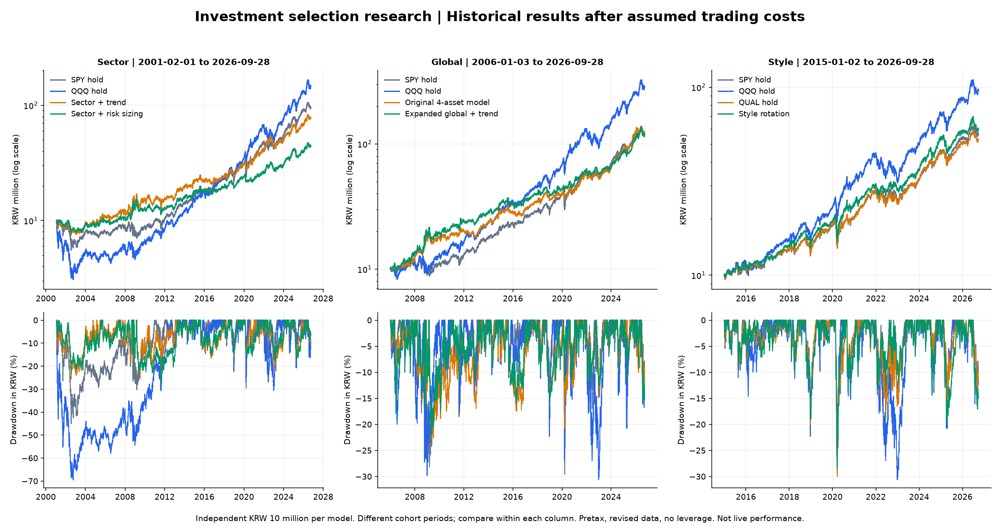

# 투자 대상 선정·위험 배분: 실제 자료 연구 결과

2026-09-29. [사전 설계](#사전-설계와-실행-중-변경) · [재현 안내](selection-research-guide.md) · [423개 전체 비교 JSON](selection-research-results-2026-09-29.json)

**ETF 315개 조건과 공개 재무 포트폴리오 108개 조건, 총 423개 비교를 완료했다.** 수집은 실제 24개 ETF 가격, Fed 환율, Cboe VIX, French 재무 포트폴리오 원문이다. 합성 시험 결과를 투자 성과로 대체하지 않았다. 새 17개 선정/비중 규칙과 장·단기 조합, 기존 기준선을 사용했다.

## 판단

1. **더 많은 ETF를 고르고 위험 비중을 조절한다고 수익이 자동으로 개선되지는 않았다.** 업종 상대 강도는 2001년 이후 원화 연복리 9.27%로 SPY 9.18%와 차이가 작았다. 추세/위험 배분 모델은 SPY보다 원화 낙폭이 작았지만 수익도 낮았다.
2. **세계 자산 확대는 동일 비중 대비 개선됐지만 기존 4자산 모델을 뚜렷하게 능가하지 못했다.** 세계 9자산 선정+추세는 12.56%/-22.13%, 기존 4자산 모델은 12.85%/-22.76%다. 수익과 낙폭의 작은 차이로 모델 교체를 정당화하기 어렵다.
3. **스타일 선정과 퀄리티·모멘텀 조합은 관찰 후보다.** 2015년 이후 스타일 순환 16.40%, QUAL·MTUM 동일 비중 16.38%, SPY 15.79%. 다만 QQQ 21.25%에는 미달한다. 비용 4배에서는 순환이 15.35%로 내려가 SPY 15.74%보다 낮지만 단순 조합은 16.32%로 남는다. 기간별 우열도 바뀐다.
4. **재무 특성에는 추가 연구할 근거가 있다.** 1965년 이후 공개 자료에서 고수익성 포트폴리오는 USD 연복리 12.11%, 저수익성 8.39%, 시장 10.75%다. 다만 이것은 재무 기준으로 이미 구성된 연구 포트폴리오의 월별 수익이며, 우리가 개별 기업을 직접 선정해 실거래한 성과가 아니다. QUAL의 실제 거래 이력은 2013년부터이고 이번 2015년 이후 QUAL 보유는 SPY를 이기지 못했다.
5. **원화 투자자는 달러 변동성을 줄이는 것만으로 충분하지 않다.** 세계 위험 배분은 USD 실현 변동성을 14.57%→11.60%로 낮췄지만 원화 최대 낙폭은 -22.13%→-22.16%로 개선되지 않았다. 환율과 손실 경로가 함께 작용한다.
6. **단기를 추가해도 이번에는 수익 개선이 없었다.** 업종 추세 70%+QQQ 단기 눌림목 30%는 2001년 이후 연복리 7.23%, 낙폭 -25.04%다. 순수 업종 추세 8.32%/-25.64%보다 수익이 낮고 낙폭 개선도 작았다.

이번 결과로 채택할 새로운 ‘최고 모델’을 확정하지 않는다. 후속 관찰 대상으로는 **기존 4자산 모델을 유지하면서 QUAL·MTUM 단순 조합과 스타일 순환을 비교**할 근거가 있다. 사후 최고값으로 기본 설정을 바꾸거나 주문을 켜지 않았다.

각 열의 시작 기간이 다르다. 동일 열 안에서 비교한다. 위는 원화 평가액의 로그 축, 아래는 원화 일별 낙폭이다. 그림은 저장된 원장을 읽어 생성했고 표시·범례·기간을 직접 확인했다.

## 비교 조건

- 업종: **2001-02-01~2026-09-28**. 2000년 초부터의 닷컴 붕괴 전체가 아니다.
- 세계 자산: **2006-01-03~2026-09-28**. GLD 등 실제 상품 출범 뒤 준비 기간을 확보했다.
- 투자 스타일: **2015-01-02~2026-09-28**. QUAL/MTUM 출범 전 가격을 만들지 않았다.
- 각각 초기 1,000만원, 추가 납입·차입·공매도 없음. 기본 USD 현금 0% 이자. 편도 수수료 2.5bp, 슬리피지 5bp, 환전 10bp 가정. 종가 판단→다음 거래 시가 체결. 세전이며 끝의 보유분은 평가만 한다.
- 수정 가격 소수점 연구 단위로 배당·분할 효과를 반영한다. 실제 배당 지급일·원천징수·정수 주수·실제 주문 체결은 재현하지 않는다. ETF 보수는 가격에 포함되어 이중 차감하지 않는다.
- 선택은 63/126/252일 상대 강도, 추세는 양의 상대 강도와 200일 평균, 위험 배분은 63일 공분산·역변동성·연율 12% USD 목표다. 월별 선정/주별 위험 갱신, 목표와 3%p 이상 차이일 때 매매한다. 상세 규칙은 실행 안내를 따른다.
- 아래 표의 연복리는 **KRW**, 낙폭은 **일별**이며 부호가 음수다. 재무 표의 통화·빈도는 별도 표시한다.

<!-- GENERATED_TABLES -->

## 미국 업종 — 2001-02-01~2026-09-28

| 모델 | 원화 연복리 | 원화 최대 낙폭 | USD 최대 낙폭 | 평균 ETF 비중 | 매매 건수 |
| --- | ---: | ---: | ---: | ---: | ---: |
| SPY 장기 보유 | 9.18% | -45.09% | -55.19% | 100.00% | 1 |
| QQQ 장기 보유 | 11.01% | -69.47% | -69.21% | 100.00% | 1 |
| QQQ 월별 추세 100/50 | 11.41% | -43.03% | -41.50% | 86.38% | 65 |
| QQQ 추세+목표 변동성 | 6.83% | -32.14% | -22.66% | 54.07% | 372 |
| 미국 업종 동일 비중 | 9.13% | -41.24% | -49.99% | 96.86% | 43 |
| 미국 업종 상대 강도 | 9.27% | -33.79% | -46.09% | 99.60% | 490 |
| 미국 업종 상대 강도+추세 | 8.32% | -25.64% | -26.88% | 88.09% | 473 |
| 미국 업종 추세+위험 배분 | 5.96% | -27.09% | -20.80% | 74.27% | 952 |
| 업종 순위 완충 | 7.36% | -29.70% | -23.95% | 87.05% | 304 |
| 업종 추세 70 + 단기 RSI 30 | 7.23% | -25.04% | -21.93% | 72.83% | 867 |
| 상승 추세 RSI 과매도 | 2.46% | -29.97% | -14.53% | 11.18% | 394 |

## 세계 자산 — 2006-01-03~2026-09-28

| 모델 | 원화 연복리 | 원화 최대 낙폭 | USD 최대 낙폭 | 평균 ETF 비중 | 매매 건수 |
| --- | ---: | ---: | ---: | ---: | ---: |
| SPY 장기 보유 | 12.72% | -29.62% | -55.19% | 100.00% | 1 |
| QQQ 장기 보유 | 17.53% | -30.64% | -53.40% | 100.00% | 1 |
| QQQ 월별 추세 100/50 | 15.66% | -26.51% | -40.33% | 89.60% | 42 |
| QQQ 추세+목표 변동성 | 9.33% | -23.96% | -22.66% | 59.70% | 345 |
| 세계 자산 동일 비중 | 10.28% | -20.20% | -36.72% | 97.97% | 50 |
| 세계 자산 상대 강도 | 12.50% | -22.16% | -28.55% | 99.57% | 345 |
| 세계 자산 상대 강도+추세 | 12.56% | -22.13% | -20.44% | 93.58% | 333 |
| 세계 자산 추세+위험 배분 | 10.52% | -22.16% | -18.53% | 81.55% | 734 |
| 세계 자산 주식그룹 60% 제한 | 9.74% | -22.16% | -14.96% | 68.46% | 610 |
| 세계 자산 위험 배분+단기국채 | 10.62% | -22.21% | -18.20% | 99.05% | 1035 |
| 주식·금·채권 모멘텀 | 12.85% | -22.76% | -23.15% | 93.05% | 178 |

## 투자 스타일 — 2015-01-02~2026-09-28

| 모델 | 원화 연복리 | 원화 최대 낙폭 | USD 최대 낙폭 | 평균 ETF 비중 | 매매 건수 |
| --- | ---: | ---: | ---: | ---: | ---: |
| SPY 장기 보유 | 15.79% | -29.62% | -33.72% | 100.00% | 1 |
| QQQ 장기 보유 | 21.25% | -30.64% | -35.12% | 100.00% | 1 |
| QQQ 월별 추세 100/50 | 18.76% | -26.51% | -28.56% | 90.84% | 21 |
| QQQ 추세+목표 변동성 | 10.08% | -23.96% | -22.66% | 58.94% | 193 |
| 투자 스타일 동일 비중 | 15.10% | -30.07% | -34.08% | 99.03% | 17 |
| 투자 스타일 상대 강도 | 16.40% | -28.53% | -32.76% | 99.92% | 94 |
| 투자 스타일 상대 강도+추세 | 12.60% | -20.17% | -22.06% | 88.13% | 106 |
| 투자 스타일 추세+위험 배분 | 8.63% | -18.28% | -21.07% | 73.54% | 321 |
| QUAL 장기 보유 | 15.16% | -30.05% | -34.06% | 100.00% | 1 |
| QUAL·MTUM 동일 비중 | 16.38% | -30.03% | -34.07% | 100.00% | 12 |

## 비용·체결·현금 통화

각 칸은 `원화 연복리 / 원화 최대 낙폭`. 비용 4배는 모든 편도 수수료·슬리피지·환전 가정을 4배 적용한다.

| 모델/기간 | 기본 | 비용 4배 | 체결 1일 지연 | KRW 현금 |
| --- | ---: | ---: | ---: | ---: |
| 미국 업종 상대 강도 (2001~) | 9.27% / -33.79% | 7.87% / -34.20% | 8.79% / -34.37% | 8.70% / -33.40% |
| 미국 업종 상대 강도+추세 (2001~) | 8.32% / -25.64% | 6.97% / -27.25% | 8.08% / -27.58% | 7.65% / -22.86% |
| 업종 추세 70 + 단기 RSI 30 (2001~) | 7.23% / -25.04% | 5.71% / -28.43% | 7.06% / -24.67% | 6.53% / -18.46% |
| 세계 자산 상대 강도+추세 (2006~) | 12.56% / -22.13% | 11.30% / -22.31% | 12.27% / -23.20% | 11.97% / -21.99% |
| 세계 자산 추세+위험 배분 (2006~) | 10.52% / -22.16% | 9.21% / -22.63% | 10.31% / -22.97% | 10.36% / -18.14% |
| 세계 자산 위험 배분+단기국채 (2006~) | 10.62% / -22.21% | 8.96% / -22.73% | 10.51% / -22.60% | 9.93% / -21.55% |
| 주식·금·채권 모멘텀 (2006~) | 12.85% / -22.76% | 11.91% / -22.76% | 12.87% / -23.26% | 11.91% / -22.54% |
| 투자 스타일 상대 강도 (2015~) | 16.40% / -28.53% | 15.35% / -28.53% | 16.02% / -28.54% | 15.95% / -28.52% |
| QUAL·MTUM 동일 비중 (2015~) | 16.38% / -30.03% | 16.32% / -30.03% | 16.51% / -30.03% | 16.38% / -30.03% |
| SPY 장기 보유 (2015~) | 15.79% / -29.62% | 15.74% / -29.62% | 15.90% / -29.62% | 15.79% / -29.62% |

SHY 방어는 기본 위험 배분보다 수익 증가가 작고 비용이 늘었다. 위험 예산으로 남긴 현금을 다시 단기국채로 채우는 것이 항상 유리하지는 않았다.

## 위험 배분 요소 분리

아래는 각 후보군의 기본 위험 배분을 기준으로 일부 설정만 변경한 진단이다. 기본값을 사후 최고값으로 교체하지 않았다. `역변동성만`은 목표 변동성 축소를 끄고 월말에만 갱신한다. 따라서 주별 갱신 제거 효과도 포함하며 순수한 단일 변수 인과효과로 해석하지 않는다.

| 후보군 | 기본 12%·주별 | 목표 축소 없이 역변동성 | 동일 비중+변동성 | 12%·월별 | 10%·주별 | 15%·주별 |
| --- | ---: | ---: | ---: | ---: | ---: | ---: |
| sector | 5.96% / -27.09% | 7.54% / -26.10% | 6.22% / -26.94% | 6.27% / -28.64% | 5.09% / -27.88% | 6.67% / -26.17% |
| global | 10.52% / -22.16% | 12.38% / -22.80% | 10.41% / -22.16% | 11.06% / -22.27% | 9.72% / -22.68% | 11.40% / -22.68% |
| style | 8.63% / -18.28% | 12.43% / -19.88% | 8.85% / -18.20% | 9.45% / -19.31% | 7.90% / -18.42% | 9.86% / -19.87% |

## 구간별 재시작 비교

각 구간마다 초기자금을 새로 투입한 비교다. 하나의 장기 계좌를 잘라낸 값과 다르다. `연복리 / 낙폭`이며, 최근 구간도 미사용 테스트가 아니다.

### sector

| 모델 | 2001~2012 | 2013~2019 | 2020~2023 | 2024~2026 |
| --- | ---: | ---: | ---: | ---: |
| SPY 장기 보유 | 0.80% / -45.09% | 15.64% / -18.96% | 14.98% / -29.62% | 22.85% / -17.11% |
| QQQ 장기 보유 | -0.85% / -69.47% | 20.67% / -22.34% | 21.63% / -30.64% | 27.17% / -20.79% |
| QQQ 월별 추세 100/50 | 2.04% / -43.03% | 17.84% / -16.19% | 22.74% / -26.51% | 21.78% / -17.65% |
| 미국 업종 상대 강도 | 2.86% / -33.79% | 11.96% / -14.32% | 18.23% / -27.10% | 17.98% / -15.93% |
| 미국 업종 상대 강도+추세 | 3.68% / -25.64% | 9.94% / -16.68% | 12.77% / -22.27% | 17.98% / -15.93% |
| 미국 업종 추세+위험 배분 | 2.04% / -27.09% | 9.02% / -15.34% | 5.99% / -17.74% | 15.10% / -16.32% |

### global

| 모델 | 2006~2012 | 2013~2019 | 2020~2023 | 2024~2026 |
| --- | ---: | ---: | ---: | ---: |
| SPY 장기 보유 | 4.74% / -28.18% | 15.64% / -18.96% | 14.98% / -29.62% | 22.85% / -17.11% |
| QQQ 장기 보유 | 8.45% / -29.85% | 20.67% / -22.34% | 21.63% / -30.64% | 27.17% / -20.79% |
| QQQ 월별 추세 100/50 | 7.17% / -17.97% | 17.84% / -16.19% | 22.74% / -26.51% | 21.78% / -17.65% |
| 세계 자산 상대 강도 | 13.14% / -22.16% | 9.38% / -15.23% | 8.98% / -20.05% | 23.66% / -16.73% |
| 세계 자산 상대 강도+추세 | 13.00% / -22.13% | 8.79% / -16.02% | 10.70% / -12.71% | 23.66% / -16.73% |
| 세계 자산 추세+위험 배분 | 10.54% / -22.16% | 8.22% / -15.26% | 8.18% / -12.56% | 19.50% / -14.96% |

### style

| 모델 | 2015~2019 | 2020~2023 | 2024~2026 |
| --- | ---: | ---: | ---: |
| SPY 장기 보유 | 12.74% / -18.96% | 14.98% / -29.62% | 22.85% / -17.11% |
| QQQ 장기 보유 | 17.84% / -22.34% | 21.63% / -30.64% | 27.17% / -20.79% |
| QQQ 월별 추세 100/50 | 14.09% / -16.19% | 22.74% / -26.51% | 21.78% / -17.65% |
| 투자 스타일 상대 강도 | 13.93% / -19.16% | 16.98% / -28.55% | 20.17% / -19.99% |
| 투자 스타일 상대 강도+추세 | 9.56% / -20.17% | 12.24% / -17.95% | 18.95% / -19.99% |
| 투자 스타일 추세+위험 배분 | 8.90% / -18.28% | 6.23% / -18.16% | 11.73% / -16.87% |
| QUAL·MTUM 동일 비중 | 14.49% / -20.93% | 12.39% / -30.03% | 26.47% / -18.58% |

## 차이가 우연일 가능성에 대한 진단

월별 원화 로그수익 차이를 12개월 블록으로 1,000회 재표본했다(고정 난수 시드). 미완료 가능성이 있는 마지막 달은 제외했다. 값은 CAGR의 단순 차이가 아니라 **연율 상대 성장률**이며, 95% 범위는 모델 탐색 횟수를 보정하지 않은 탐색용이다. 아래 범위가 모두 0을 포함하므로 안정적인 초과수익을 확인했다고 말할 근거는 부족하다.

| 비교 | 연율 상대 성장률 | 재표본 95% 범위 |
| --- | ---: | ---: |
| 미국 업종 상대 강도 / SPY 장기 보유 | 0.05% | -3.12%~3.34% |
| 세계 자산 상대 강도+추세 / 세계 자산 동일 비중 | 1.98% | -1.21%~5.32% |
| 투자 스타일 상대 강도 / SPY 장기 보유 | 0.42% | -2.31%~2.99% |
| QUAL·MTUM 동일 비중 / SPY 장기 보유 | 0.28% | -2.15%~2.60% |

## 재무 특성: 별도 월별 진단

출처가 구성한 시가총액 가중 포트폴리오 수익을 사용한다. **실제 매매 가능한 개별 주식 전략 성과가 아니며, 내부 회전 비용·세금은 미확인이다.** 기본 외부 교체 비용 7.5bp, 추가 연간 비용 0% 조건이다. 월별 낙폭은 일별 낙폭보다 작게 나타날 수 있다.

| 모델 | 1965-01~2026-08 USD 연복리 / 월말 낙폭 | 2001-02~2026-08 KRW 연복리 / 월말 낙폭 |
| --- | ---: | ---: |
| 미국 시장 | 10.75% / -50.31% | 9.64% / -39.12% |
| 영업수익성 상위 30% | 12.11% / -47.97% | 11.28% / -32.47% |
| 영업수익성 하위 30% | 8.39% / -69.88% | 6.20% / -58.15% |
| 장부가/시가 상위 30% | 13.81% / -61.24% | 10.53% / -40.53% |
| 장부가/시가 하위 30% | 10.57% / -51.29% | 10.36% / -43.17% |
| 고수익성·가치 50:50 | 13.10% / -50.81% | 11.10% / -34.10% |
| 고수익성+추세 | 10.58% / -30.83% | 11.24% / -18.49% |
| 고수익성·가치+추세 | 10.31% / -28.69% | 8.98% / -27.17% |
| 시장+추세 | 9.62% / -29.85% | 9.93% / -19.64% |

고수익성 포트폴리오의 1965년 이후 USD 연복리는 추가 연간 비용 1%를 가정하면 10.99%, 2%면 9.87%다. 이 추가 비용은 실측 수수료가 아니며 내부 매매/구현 오차에 대한 민감도다. 전체 JSON에는 시장 기준선에도 같은 비용을 적용한 결과를 포함했다. 공개 연구 특성의 효과와 실제 구현 가능한 순수익은 구분한다.
<!-- END_GENERATED_TABLES -->

## 검증과 한계

- 새 22개 검사를 포함해 **백엔드 393개 통과**, 기존 FastAPI/httpx 사용 중단 예정 경고 1개. Ruff lint/format 전체 통과(102개 Python 파일).
- **315개 ETF 원장과 108개 재무 월별 결과 전부 다시 읽어 검증**했다. 현금·보유량·수수료·환전·평가, 재무 구성별 잔액과 복리, 독립 NumPy CAGR/낙폭, 모든 선정 목표의 자금/변동성/개별/그룹 상한을 검사했다.
- 원문 29개와 데이터셋/개별 결과 내용 해시를 대조했다. ETF 원장 최대 오차는 **0.000000227243원**으로 0.01원 이내였다.
- 기존 QQQ 보유·월별 추세·4자산 순환·RSI 모델을 **기존 원문**으로 다시 실행해 거래·평가액·의사결정·지표·감사가 이전 결과와 완전히 일치했다. 신규 자료 수집은 제공자의 현재 수정본이므로 이전 원문과 소수점 차이는 있을 수 있다.
- 개별 실행 명령과 오프라인 동일 실행 ID 재현을 확인했다. 전체 행렬은 실패 0건이다. 첫 재검증에서 조합에 구성 전략 하나의 위험 진단이 남는 표시 문제를 발견해 분리하고 전체 결과를 재생했다. 이 수정으로 수익률이 바뀌지는 않았다.
- **국내 재무 직접 선정은 검증하지 못했다.** 가져온 최신 국내 연구 데이터셋은 `financial_facts=0`이었다. 540,865개 일봉과 168개 기업행동 항목을 재무 공시 패널로 간주하지 않았다. 개별 KOSPI 구현 확장에는 접수번호별 재무 원문·정정·발표일·업종 비교·전체 권리 처리 검증이 더 필요하다.
- 과거 상품 전체가 아닌 현재 생존 대표 ETF 목록이며 업종/지수 방법론도 변경될 수 있다. 가격·환율·재무 집계는 현재 수정본이다. `performance_validated=false`를 유지한다. 원장 검증 성공은 미래 초과수익이나 당시 공개본(PIT) 검증 성공을 뜻하지 않는다.
- 공개 재무 포트폴리오는 내부 종목 교체·호가·시장충격·세금·실제 재무 공시 시각을 재구축하지 않았다. 월말 낙폭을 ETF의 일별 낙폭과 직접 비교하면 안 된다. 금융정보 원천은 2025년부터 CRSP CIZ 형식으로 전환됐고 배당 재투자 방식 설명도 확인했다.
- 여러 역사 구간과 423개 조건을 이미 살펴본 연구다. 최고 결과만 선택하지 않으며 미사용 검증/미래 성공 확률을 주장하지 않는다. 실거래·모의 주문·웹 등록·인프라 배포는 하지 않았다. 코드·결과의 공유 상태는 저장소 커밋 이력으로 확인한다.

## 재현 증거

엔진: `f7101278c2586fd7c406ba0aa6db005e76cf5e4a063dfba1a1e51a9a2a40713f`.

- `.local/selection-research/suite-f7101278c258.json`: ETF 315 + 재무 108 전체 비교.
- `.local/selection-research/audit-f7101278c258.json`: 원문/원장/지표 대조, 실현 변동성, 월별 상대 성과 재표본 진단.
- `.local/selection-research/old-engine-regression.json`: 이전 원문/실행 ID를 사용한 4개 기존 모델의 완전 일치.
- `.local/selection-research/runs/`: 모든 매매·일별 평가·연도별 결과·선정 비중·재무 월별 원장.
- [요약 JSON](selection-research-results-2026-09-29.json), [PNG](images/selection-research-2026-09-29.png): 다른 PC에서 바로 볼 수 있는 산출물. 중복 SVG는 정리했으며 필요하면 그림 스크립트의 출력 경로를 지정해 재생성한다.

## 조사 근거

- [Faber 상대 강도 원문](https://mebfaber.com/wp-content/uploads/2018/12/SSRN-id1585517-Relative-Strength-Strategies-for-Investing.pdf): 업종/세계 자산 상대 강도와 추세 연구. 본 구현은 논문의 성과 재현을 주장하지 않는다.
- [Moreira·Muir 변동성 관리](https://www.nber.org/papers/w22208): 위험 배분 가설의 근거이며 절대수익 증가 보장이 아니다.
- [QUAL 공식 설명](https://www.ishares.com/us/products/256101/ishares-msci-usa-quality-factor-etf): ROE·이익 안정성·부채 기준과 실제 상품 출범.
- [MTUM 공시](https://www.sec.gov/Archives/edgar/data/1100663/000119312525302119/d28465d497k.htm), [USMV 공식 설명](https://www.ishares.com/us/products/239695/), [IWD/IWF 상품 목록](https://www.ishares.com/us/products/etf-investments): 스타일 후보의 모멘텀·저변동성·가치·성장 분류를 확인했다.
- [French 자료](https://mba.tuck.dartmouth.edu/pages/faculty/ken.french/data_library.html), [수익성 정의](https://mba.tuck.dartmouth.edu/pages/faculty/ken.french/Data_Library/det_port_form_op.html): 전년도 재무를 이용한 6월 구성과 월별 시가총액 가중 수익률.
- [AQR 비용 연구](https://www.aqr.com/Insights/Research/Working-Paper/Trading-Costs-of-Asset-Pricing-Anomalies), [과최적화 연구](https://www.davidhbailey.com/dhbpapers/backtest-prob.pdf): 비용/회전율과 반복 탐색의 한계를 반영했다.

## 사전 설계와 실행 중 변경

원래 별도 계획 문서에 기록한 범위와 가정을 보존한 부록이다. 최신 결론은 이 보고서 본문과 [종합 판단](research-conclusions-2026-09-29.md)을 따른다.

목표는 투자 대상 확대, 상대 강도/재무 특성 선정, 투자 비중 조절이 비용 후 계좌 성과를 개선하는지 실제 자료로 검증하는 것이다. 기존 국내/ETF 연구와 원문은 보존한다. 주문·운용 활성화, 웹 화면, 배포는 포함하지 않는다.

### 결과를 보기 전에 고정한 연구

1. **미국 업종**: 1998년 출범한 9개 SPDR 업종 ETF(XLB/XLE/XLF/XLI/XLK/XLP/XLU/XLV/XLY). 동일 비중, 상대 강도 상위 3개, 추세 필터 추가, 투자 비중 조절 추가를 단계별 비교한다. 나중에 출범한 XLRE/XLC를 과거에 소급하지 않는다. 업종 정의 변경과 현재 생존 상품 선택 편향은 남는다.
2. **세계 자산**: SPY/QQQ/IWM/EFA/EEM/IYR/IEF/TLT/GLD. 동일 비중과 상위 3개 상대 강도, 추세, 비중 조절을 비교한다. 주식·부동산을 하나의 위험 그룹으로 묶어 그룹 총 60% 제한도 별도 비교한다.
3. **투자 스타일**: QUAL/MTUM/IWD/IWF/USMV. 실제 거래된 상품으로 퀄리티·모멘텀·가치·성장·저변동성의 보유/선택/조합을 비교한다. 재무는 지수 제공자의 종목 선정에 간접 반영된다. 자체 개별 주식 재무 선정 성과라고 부르지 않는다.
4. **재무 장기 진단**: Kenneth French의 영업수익성·장부가/시가 기준 역사 포트폴리오를 내려받아 높은/낮은 특성, 보유 및 추세 결합을 비교한다. 포트폴리오 수익률 집계 자료이므로 구성종목 재구축, 실제 체결·내부 회전 비용/PIT 공시 검증을 완료한 전략이 아니다. ETF 결과와 별도 표로 보고한다.
5. **장·단기 조합**: 업종 선택에 QQQ 단기 눌림목을 추가하는 초기 자금 70:30 구획을 순수 업종 선택 및 장기 기준선과 비교한다. 구성 전략의 자금은 중복 사용하지 않는다.

국내 자료 조사에서는 로컬 DART가 감자·분할 등 기업행동 원문과 공시 목록 중심임을 확인했다. 이를 완전한 과거 재무 패널로 간주하지 않는다. 개별 KOSPI 재무 선정 검증에는 기업별 접수번호 재무 원문과 당시 유니버스·기업행동 정합성이 더 필요하다.

### 고정 규칙과 평가 계약

- 상대 강도: 63/126/252 거래일 총수익의 산술 평균. 월말 상위 3개(스타일은 2개). 추세 필터는 양의 상대 강도이면서 200일 평균 위. 탈락 몫은 현금으로 유지하며 다른 자산에 자동 재분배하지 않는다.
- 비중: 선택 자산 간 최근 63일 변동성 역수 배분, 개별 최대 40%(스타일 60%). 최근 63일 공분산을 사용해 연율 목표 12%보다 위험이 크면 전체 배분을 축소한다. 무차입·공매도 없음. 목표는 미래 손실 상한이 아니다.
- 선정은 월말, 위험 비중 갱신은 주말 종가(추가 월별 버전 비교). 모든 주문은 다음 실제 세션 시가, 하루 지연 민감도 별도. 매매 비중 오차 허용 3%p.
- 매도/회전 대조: 기존 상위 종목이 상위 5위 안이면 유지하는 완충 규칙. 결과를 보고 순위·기간을 최적화하지 않는다.
- 기본 방어는 USD 현금 0% 이자. KRW 현금 및 SHY 단기국채 ETF에 잔여 비중 배분하는 비교를 각각 둔다. SHY는 현금과 달리 가격/금리 위험과 거래 비용이 있다.
- 기준선: 동일 기간 SPY·QQQ 장기 보유, 기존 QQQ 월별 추세, 기존 4자산 모멘텀(가능 기간), 각 유니버스 동일 비중. 보유 상품의 운용보수는 가격에 반영되어 별도 이중 차감하지 않는다.
- 원화 1천만원, 편도 수수료 2.5bp/슬리피지 5bp/환전 10bp. 비용 2배/4배, 1세션 지연, 원화 현금, 평가 구간 분리. 세금·정수 주수·배당 실제 지급일은 미반영이며 수정 가격 소수점 연구 단위다.
- 업종은 2001년 이후, 세계 자산은 2006년 이후, 스타일은 2015년 이후로 자료 준비 기간을 확보한다. 각 기간의 시작/끝은 실제 자료에서 검증한다. 모든 구간은 이미 공개된 역사적 재실험이며 깨끗한 미사용 검증이라고 주장하지 않는다.
- 연복리·최대 낙폭·변동성·회복 기간·매매/회전율·평균 투자 비중·연도별 성과를 보고한다. KRW와 USD를 함께 측정하며 단순 최고 수익을 자동 채택하지 않는다.
- 데이터 해시/코드 해시/규칙/시나리오/실패를 보존하고 개별 원장을 다시 대조한다. 여러 조합을 시험했다는 사실과 전체 결과를 남긴다.

### 근거

- [Faber, Relative Strength Strategies for Investing](https://mebfaber.com/wp-content/uploads/2018/12/SSRN-id1585517-Relative-Strength-Strategies-for-Investing.pdf): 업종/세계 자산 상대 강도와 추세 결합. 본 구현은 자체 고정 규칙이며 논문 완전 복제가 아니다.
- [Moreira·Muir, Volatility Managed Portfolios](https://www.nber.org/papers/w22208): 변동성에 따른 위험 배분의 연구 근거. 본 무차입 목표 변동성 규칙과 논문 포트폴리오는 다르다.
- [QUAL 공식 상품 설명](https://www.ishares.com/us/products/256101/ishares-msci-usa-quality-factor-etf): 높은 ROE, 안정적인 이익, 낮은 부채를 활용하는 지수 추종; 2013-07-16 출범.
- [French 영업수익성 포트폴리오 정의](https://mba.tuck.dartmouth.edu/pages/faculty/ken.french/Data_Library/det_port_form_op.html): 매년 6월에 전년도 회계자료로 구성. 현재 내려받은 집계 수익률은 역사 공시 원문 검증의 대체물이 아니다.
- [AQR 거래 비용 연구](https://www.aqr.com/Insights/Research/Working-Paper/Trading-Costs-of-Asset-Pricing-Anomalies), [백테스트 과최적화](https://www.davidhbailey.com/dhbpapers/backtest-prob.pdf): 비용·회전과 반복 실험의 영향을 별도 확인한다.
